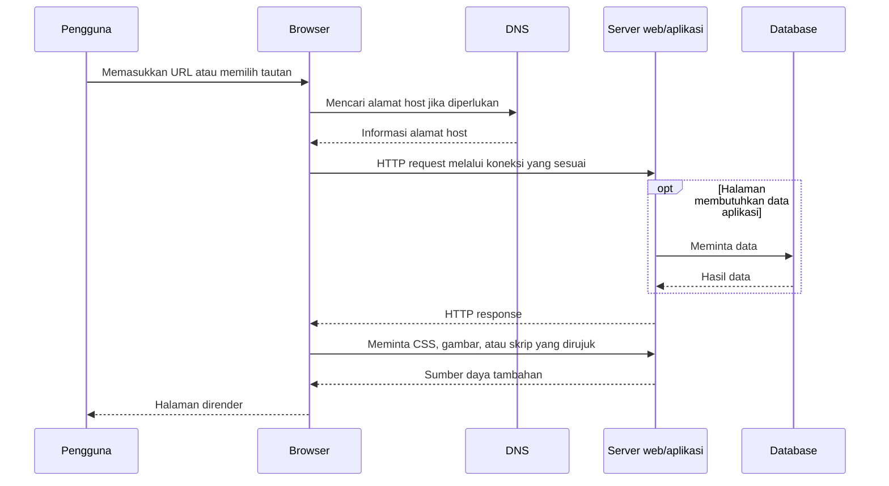

# Materi Lengkap 3 Minggu Quiz Pemrograman Web

**Mata kuliah:** IFB-211 Pemrograman Web, ITENAS  
**Cakupan:** dasar web, struktur navigasi, HTML, CSS, dan latihan kartu profil  
**Sumber:** seluruh 17 berkas dalam `01_Materi_3_Minggu_Quiz/`  
**Tanggal penyusunan:** 12 Oktober 2026

Dokumen ini menggabungkan materi yang berulang dari PPTX, PDF, dan Canva menjadi satu alur belajar. Definisi dijelaskan kembali, contoh kode diberi alasan penggunaannya, dan topik tambahan dari setiap sumber tetap dimasukkan. Kode latihan asli tersedia lengkap di lampiran.

**Cara membaca:** pelajari konsep pada Bab 3–11, hubungkan dengan latihan pada Bab 12, lalu gunakan Bab 14–15 untuk mengecek pemahaman. Bab 2 memuat informasi perkuliahan yang tercantum dalam sumber. Bab 13 menjelaskan kesalahan atau penyederhanaan pada slide agar tidak menjadi hafalan yang keliru.

**Batas sumber:** informasi kontrak dan penugasan merupakan isi berkas lokal, bukan konfirmasi terbaru dari LMS. Penjelasan tambahan dan latihan soal dalam dokumen ini disusun untuk belajar; soal tersebut bukan kisi-kisi resmi atau prediksi soal dosen. Materi PHP, JavaScript lanjutan, MVC, dan Laravel dari folder lain tidak dibahas sebagai bab tersendiri.

## Daftar Isi

1. [Daftar sumber dan cara penggabungan](#1-daftar-sumber-dan-cara-penggabungan)
2. [Pengantar dan kontrak perkuliahan](#2-pengantar-dan-kontrak-perkuliahan)
3. [Dasar pemrograman web](#3-dasar-pemrograman-web)
4. [Struktur navigasi website](#4-struktur-navigasi-website)
5. [HTML: struktur dan isi halaman](#5-html-struktur-dan-isi-halaman)
6. [CSS: sintaks dan cara penerapan](#6-css-sintaks-dan-cara-penerapan)
7. [Selector, combinator, dan prioritas CSS](#7-selector-combinator-dan-prioritas-css)
8. [Warna teks dan elemen](#8-warna-teks-dan-elemen)
9. [Tipografi dan text formatting](#9-tipografi-dan-text-formatting)
10. [Box model, ukuran, dan layout](#10-box-model-ukuran-dan-layout)
11. [Background warna, gambar, dan gradient](#11-background-warna-gambar-dan-gradient)
12. [Pembahasan latihan kartu profil](#12-pembahasan-latihan-kartu-profil)
13. [Pelurusan istilah dan kesalahan sumber](#13-pelurusan-istilah-dan-kesalahan-sumber)
14. [Latihan soal beserta pembahasan](#14-latihan-soal-beserta-pembahasan)
15. [Ringkasan dan checklist belajar](#15-ringkasan-dan-checklist-belajar)
16. [Lampiran kode latihan asli](#16-lampiran-kode-latihan-asli)
17. [Peta cakupan sumber dan referensi klarifikasi](#17-peta-cakupan-sumber-dan-referensi-klarifikasi)

## 1. Daftar sumber dan cara penggabungan

Semua tautan sumber di tabel berikut relatif terhadap lokasi dokumen ini. Berkas sumber berada di `_tools/Materi-Kuliah-Elearning/01_Materi_3_Minggu_Quiz/`.

| No. | Berkas sumber | Halaman/slide | Isi yang digunakan |
| --- | --- | ---: | --- |
| 1 | [01_Dasar_Pemrograman_Web.pptx](_tools/Materi-Kuliah-Elearning/01_Materi_3_Minggu_Quiz/01_Dasar_Pemrograman_Web.pptx) | 24 | Website, jenis web, istilah, navigasi, editor, dan tugas |
| 2 | [01_Dasar_Pemrograman_Web.pdf](_tools/Materi-Kuliah-Elearning/01_Materi_3_Minggu_Quiz/01_Dasar_Pemrograman_Web.pdf) | 24 | Pasangan PDF sumber 1, termasuk diagram navigasi |
| 3 | [01_Canva_Prodi_Informatika.pdf](_tools/Materi-Kuliah-Elearning/01_Materi_3_Minggu_Quiz/01_Canva_Prodi_Informatika.pdf) | 17 | Kontrak kuliah, client–server, HTTP, URL, peran developer, etika |
| 4 | [01_Canva_Teknik_Informatika_SI.pdf](_tools/Materi-Kuliah-Elearning/01_Materi_3_Minggu_Quiz/01_Canva_Teknik_Informatika_SI.pdf) | 17 | **Struktur HTML5, DOM, semantik, multimedia, form, dan validasi** |
| 5 | [02_Pemrograman_HTML.pptx](_tools/Materi-Kuliah-Elearning/01_Materi_3_Minggu_Quiz/02_Pemrograman_HTML.pptx) | 28 | Struktur, tag, elemen, atribut, paragraf, dan heading |
| 6 | [02_Pemrograman_HTML.pdf](_tools/Materi-Kuliah-Elearning/01_Materi_3_Minggu_Quiz/02_Pemrograman_HTML.pdf) | 28 | Pasangan PDF sumber 5, termasuk tabel dan contoh dalam gambar |
| 7 | [02_Pemrograman_HTML_Alt.pptx](_tools/Materi-Kuliah-Elearning/01_Materi_3_Minggu_Quiz/02_Pemrograman_HTML_Alt.pptx) | 17 | Versi HTML yang berakhir pada aturan penulisan atribut |
| 8 | [02_Pemrograman_HTML_Alt.pdf](_tools/Materi-Kuliah-Elearning/01_Materi_3_Minggu_Quiz/02_Pemrograman_HTML_Alt.pdf) | 17 | Pasangan PDF sumber 7 |
| 9 | [03_Pemrograman_CSS.pptx](_tools/Materi-Kuliah-Elearning/01_Materi_3_Minggu_Quiz/03_Pemrograman_CSS.pptx) | 16 | Jenis CSS, istilah, pseudo, padding, margin, combinator, border |
| 10 | [03_Pemrograman_CSS.pdf](_tools/Materi-Kuliah-Elearning/01_Materi_3_Minggu_Quiz/03_Pemrograman_CSS.pdf) | 16 | Pasangan PDF sumber 9 |
| 11 | [03_Canva_CSS_Versi_2.pdf](_tools/Materi-Kuliah-Elearning/01_Materi_3_Minggu_Quiz/03_Canva_CSS_Versi_2.pdf) | 18 | Sintaks, komentar, selector elemen/class/ID/atribut/universal/pseudo/group |
| 12 | [03_Canva_Mahasiswa_Pemula.pdf](_tools/Materi-Kuliah-Elearning/01_Materi_3_Minggu_Quiz/03_Canva_Mahasiswa_Pemula.pdf) | 22 | Dasar CSS, warna, tipografi, box model, unit, display, Flexbox, DevTools |
| 13 | [03_Canva_Warna_Teks_Elemen.pdf](_tools/Materi-Kuliah-Elearning/01_Materi_3_Minggu_Quiz/03_Canva_Warna_Teks_Elemen.pdf) | 10 | Nama warna, RGB, RGBA, hex, HSL, dan properti pewarnaan |
| 14 | [03_Canva_Text_Formatting.pdf](_tools/Materi-Kuliah-Elearning/01_Materi_3_Minggu_Quiz/03_Canva_Text_Formatting.pdf) | 9 | Font, perataan, arah baca, dekorasi, kapitalisasi, shadow, dan spasi |
| 15 | [03_Canva_Terima_Kasih.pdf](_tools/Materi-Kuliah-Elearning/01_Materi_3_Minggu_Quiz/03_Canva_Terima_Kasih.pdf) | 9 | **Background CSS: warna, fallback, gradient, gambar, repeat, position, size** |
| 16 | [Latihan_gemini-code_HTML.html](_tools/Materi-Kuliah-Elearning/01_Materi_3_Minggu_Quiz/Latihan_gemini-code_HTML.html) | — | Struktur kartu profil, foto, statistik, dan tautan aksi |
| 17 | [Latihan_gemini-code_CSS.css](_tools/Materi-Kuliah-Elearning/01_Materi_3_Minggu_Quiz/Latihan_gemini-code_CSS.css) | — | Styling kartu profil, variabel CSS, Flexbox, position, hover, dan transition |

Pasangan PDF/PPTX digabung berdasarkan isi, bukan dihitung sebagai bab berbeda. HTML versi alternatif memiliki 17 slide; versi utama memiliki 28 slide dan menambahkan paragraf serta heading. Cover, halaman kosong, sesi tanya jawab, dan daftar sumber gambar dicatat sebagai bagian presentasi, tetapi tidak diubah menjadi teori baru.

## 2. Pengantar dan kontrak perkuliahan

### 2.1 Pengampu dan kanal komunikasi dalam materi

Slide dasar web, HTML, dan CSS mencantumkan **Yusup Miftahuddin, S.Kom., M.T.** Canva pengantar juga mencantumkan **Anisa Putri Setyaningrum, S.Kom., M.T.** dalam informasi tim pengampu.

Kanal yang disebut pada Canva pengantar adalah Elearning ITENAS sebagai LMS, WhatsApp/Discord kelas untuk diskusi, dan GitHub Classroom sebagai repositori kode. Bagian ini merekam keterangan sumber; akun, kelas, dan tautan undangan tetap mengikuti arahan dosen.

### 2.2 Bobot penilaian pada Canva pengantar

| Komponen | Bobot dalam slide | Keterangan dalam slide |
| --- | ---: | --- |
| Kehadiran | 10% | Minimal 80% kehadiran kelas |
| Tugas | 25% | Latihan mandiri dan mingguan |
| ETS | 25% | Ujian teori dan coding pemahaman |
| UAS | 20% | Ujian akhir teori integratif |
| Proyek akhir | 20% | Pengembangan aplikasi web oleh tim |
| **Total** | **100%** | Jumlah bobot yang tertulis pada sumber |

Bobot di atas berasal dari `01_Canva_Prodi_Informatika.pdf`, halaman 3. Jika kontrak yang diumumkan di kelas berbeda, gunakan ketentuan dosen. Dokumen ini tidak membandingkan bobot tersebut dengan RPS di folder lain.

### 2.3 Peta satu semester dalam sumber

| Minggu | Tahap | Topik yang disebut |
| --- | --- | --- |
| 1–4 | Fondasi web | HTML5 semantik, form, dasar CSS3, dan box model |
| 5–7 | Styling dan layout | Flexbox, Grid, responsive web design, dan framework CSS |
| 8–11 | Interaktivitas | JavaScript dasar, DOM, event handling, dan Fetch API |
| 12–16 | Integrasi dan proyek | Backend API, database, deployment, dan presentasi |

Tabel ini menjelaskan arah perkuliahan dalam Canva. Pembahasan detail dokumen tetap berfokus pada isi folder tiga minggu.

### 2.4 Etika coding dan integritas akademik

Materi menekankan penulisan kode secara mandiri, pemahaman logika, dokumentasi yang membantu pembaca, serta penggunaan AI sebagai alat memahami konsep. Menyalin pekerjaan teman tanpa pemahaman/modifikasi dan membagikan jawaban saat ujian disebut sebagai pelanggaran. Slide menyebut sanksi nilai gugur untuk komponen terkait; penerapan sanksi mengikuti kebijakan dosen.

Kebiasaan belajar yang sesuai: ketik ulang contoh, jelaskan fungsi tiap bagian dengan kalimat sendiri, ubah satu nilai untuk melihat akibatnya, lalu kerjakan variasi tanpa membuka contoh.

### 2.5 Persiapan dan tugas yang disebut

1. Menyiapkan editor dan browser, mengaktifkan akses LMS, serta membaca pengantar HTML.
2. **Tugas 1 pada slide dasar web:** memilih satu sistem berbasis website di ITENAS dan membuat struktur navigasinya.
3. **Tugas pada Canva HTML:** membuat CV `index.html` berisi biodata serta riwayat pendidikan, menerapkan elemen semantik, kemudian commit/push ke repositori dan mengirim tautannya melalui LMS.
4. Mempelajari HTML dan CSS sebelum beralih ke framework. Bootstrap dan Tailwind hanya disebut sebagai arah belajar berikutnya, bukan materi yang dijelaskan di folder ini.

## 3. Dasar pemrograman web

### 3.1 Internet, WWW, website, dan halaman web

**Internet** adalah jaringan dari berbagai jaringan komputer yang berkomunikasi menggunakan keluarga protokol TCP/IP. Internet merupakan infrastrukturnya; layanan yang berjalan di atasnya dapat berupa web, email, dan layanan lain.

**World Wide Web (WWW)** adalah sistem dokumen dan sumber daya yang saling terhubung melalui hyperlink, diakses menggunakan browser dan layanan web. Karena itu, internet dan WWW tidak sama: web merupakan salah satu layanan yang menggunakan internet.

**Website** adalah kumpulan halaman dan sumber daya terkait. Satu website dapat memiliki halaman beranda, profil, berita, dan kontak. **Halaman web** adalah satu dokumen atau tampilan dalam website tersebut. Kontennya dapat berupa teks, gambar, animasi, audio, video, atau gabungannya.

**Aplikasi web** menyediakan fungsi yang dijalankan melalui browser, misalnya mengisi KRS, mengelola berita, atau berdiskusi. Website dan aplikasi web dapat saling tumpang tindih; sebuah situs informasi juga bisa memiliki fungsi aplikasi seperti formulir pencarian.

Definisi pada slide berfokus pada akses internet. Dalam praktik pembelajaran, halaman juga dapat dibuka secara lokal atau melalui server pada jaringan internal.

### 3.2 Jenis website

| Jenis dalam slide | Ciri utama | Contoh ilustratif | Cara perubahan konten |
| --- | --- | --- | --- |
| Statis | Konten umumnya berasal dari file yang sudah disiapkan | Halaman profil sederhana | Pengembang mengedit file lalu menerbitkannya |
| Dinamis | Konten disusun atau diperbarui berdasarkan data dan proses aplikasi | Portal berita, sistem akademik | Melalui backend, database, atau pengolahan data |
| Interaktif | Pengguna dapat saling berinteraksi atau memberikan kontribusi | Forum dan blog dengan komentar | Melalui kiriman, balasan, atau tindakan pengguna |

Materi mengelompokkan ketiganya sebagai jenis website. Secara konsep, **dinamis** dan **interaktif** tidak harus saling terpisah: forum biasanya sekaligus dinamis dan interaktif. Halaman yang disajikan sebagai file statis pun bisa memiliki interaksi di browser melalui JavaScript.

### 3.3 Peran HTML, CSS, JavaScript, dan PHP

| Teknologi | Tanggung jawab | Contoh |
| --- | --- | --- |
| HTML | Struktur dan makna konten | Judul, paragraf, gambar, daftar, form |
| CSS | Presentasi dan tata letak | Warna, font, ukuran, jarak, layout |
| JavaScript | Perilaku dan logika interaksi | Merespons klik, memperbarui DOM |
| PHP | Pengolahan di server | Menerima data form dan menghasilkan respons |

Analogi bangunan: HTML menentukan ruang dan bagian bangunan, CSS menentukan penampilannya, JavaScript mengatur perilaku perangkat yang dapat dioperasikan, dan server mengolah permintaan yang memerlukan layanan di belakang layar.

Slide memakai istilah umum “bahasa skrip pemrograman web”. Untuk pemahaman teknis, HTML merupakan bahasa markup dan CSS bahasa stylesheet; keduanya tidak berperan sama dengan bahasa pemrograman yang menjalankan logika seperti JavaScript/PHP.

### 3.4 Model client–server

**Client** adalah pihak yang meminta layanan, biasanya browser pengguna. **Server** menerima permintaan dan mengirim respons. Server dapat mengirim file yang sudah ada atau menjalankan aplikasi untuk menyusun respons berdasarkan data.



Bagan ini menyederhanakan alur. Pencarian DNS dapat memakai cache; koneksi HTTPS melibatkan TLS. Database hanya diperlukan jika aplikasi memang menggunakan data tersebut.

**Client-side** berjalan atau ditafsirkan pada sisi browser. **Server-side** berjalan pada server sebelum respons dikirim atau saat permintaan API diproses. Browser tidak menjalankan kode PHP hanya karena file PHP diunduh; PHP harus diproses oleh lingkungan server yang mendukungnya.

### 3.5 Frontend, backend, dan fullstack

| Peran | Fokus yang dijelaskan pada sumber |
| --- | --- |
| Frontend | Antarmuka, pengalaman pengguna, layout, serta interaksi browser |
| Backend | Logika bisnis, akses database, keamanan, dan layanan API |
| Fullstack | Menghubungkan pekerjaan sisi antarmuka dan sisi server |

Pembagian ini merupakan tanggung jawab pekerjaan, bukan jenis website. Dalam tugas awal, HTML/CSS terutama melatih bagian frontend.

### 3.6 Istilah penting

| Istilah | Arti | Hubungannya dengan web |
| --- | --- | --- |
| Browser | Aplikasi untuk mengakses dan merender sumber daya web | Membaca HTML, menerapkan CSS, menjalankan JavaScript |
| Web server | Perangkat lunak yang menerima permintaan HTTP dan mengirim respons | Contohnya Apache; “server” juga dapat merujuk pada mesin tempatnya berjalan |
| Hosting | Layanan penyedia tempat dan sumber daya untuk menjalankan/menyajikan situs | Menyimpan file dan menyediakan layanan yang dapat diakses |
| Domain | Nama yang mudah dibaca untuk mengidentifikasi host/situs | Misalnya `itenas.ac.id` |
| DNS | Domain Name System, sistem penamaan terdistribusi | Membantu menemukan alamat host berdasarkan nama |
| IP | Internet Protocol | Mengatur pengalamatan dan pengiriman paket antarjaringan |
| Alamat IP | Alamat numerik perangkat atau antarmuka jaringan | Berbeda dari nama domain |
| URL | Uniform Resource Locator | Alamat sebuah sumber daya, bukan hanya beranda website |
| HTTP | Hypertext Transfer Protocol | Mekanisme permintaan dan respons untuk sumber daya web |
| HTTPS | HTTP melalui koneksi yang diamankan dengan TLS | Melindungi komunikasi saat data dikirim |
| Hyperlink | Tautan menuju sumber daya atau bagian dokumen | Dapat ditempelkan pada teks maupun gambar |

**Pelurusan URL:** singkatan yang tepat adalah *Uniform Resource Locator*, meskipun salah satu slide menulis “Universal”. URL juga dapat menunjuk CSS, gambar, atau sumber daya lain. [Rujukan MDN tentang URL](https://developer.mozilla.org/en-US/docs/Learn_web_development/Howto/Web_mechanics/What_is_a_URL).

**Pelurusan XAMPP:** XAMPP merupakan paket lingkungan pengembangan yang mencakup Apache, MariaDB, PHP, dan Perl; komponen web server-nya adalah Apache. [Rujukan Apache Friends](https://www.apachefriends.org/).

### 3.7 Anatomi URL

Contoh berikut memperluas contoh pada Canva dengan fragment:

```text
https://www.kampus.ac.id:443/matakuliah/pemweb?id=101#materi
```

| Bagian | Nilai contoh | Fungsi |
| --- | --- | --- |
| Scheme | `https` | Cara/protokol mengakses sumber daya |
| Host | `www.kampus.ac.id` | Host tujuan |
| Port | `443` | Port layanan; contoh memakai port lazim HTTPS |
| Path | `/matakuliah/pemweb` | Jalur sumber daya |
| Query | `id=101` | Parameter untuk permintaan |
| Fragment | `materi` | Identifikasi bagian sumber daya, misalnya elemen `id="materi"` |

Domain saja belum merupakan URL lengkap. `https://itenas.ac.id/berita` dan `https://itenas.ac.id/profil` mempunyai host sama tetapi path berbeda. Fragment halaman dipakai browser untuk menemukan bagian dokumen; fragment tidak dikirim sebagai bagian target permintaan HTTP.

### 3.8 Metode HTTP dan status respons

| Metode dalam Canva | Maksud umum |
| --- | --- |
| GET | Mengambil representasi sumber daya |
| POST | Mengirim data untuk diproses oleh tujuan |
| PUT | Mengganti representasi sumber daya pada tujuan |
| PATCH | Menerapkan perubahan sebagian |
| DELETE | Meminta penghapusan sumber daya |

Nama metode menyatakan maksud permintaan; cara aplikasi memprosesnya ditentukan server. Form HTML biasa menggunakan GET atau POST. PUT/PATCH/DELETE dalam tabel merupakan pengenalan komunikasi aplikasi/API.

| Kode pada Canva | Makna umum | Ilustrasi |
| --- | --- | --- |
| 200 | OK | Permintaan berhasil |
| 301 | Moved Permanently | Sumber daya berpindah secara permanen |
| 302 | Found | Pengalihan sementara |
| 404 | Not Found | Sumber daya yang diminta tidak ditemukan |
| 500 | Internal Server Error | Server mengalami masalah saat memproses permintaan |

**Request** adalah pesan permintaan dari client; **response** adalah pesan jawaban server. HTTP tidak sama dengan HTML: HTTP membawa pesan dan sumber daya, sedangkan HTML merupakan salah satu format kontennya.

### 3.9 Evolusi web dalam materi

| Istilah pada Canva | Gagasan utama |
| --- | --- |
| Web 1.0 | Informasi cenderung satu arah, pengguna terutama membaca |
| Web 2.0 | Pengguna dapat membuat konten dan berinteraksi, misalnya media sosial |
| Web 3.0 | Dalam slide dikaitkan dengan data terstruktur, AI, dan desentralisasi |

Istilah ini menggambarkan kecenderungan perkembangan, bukan nomor versi HTML atau protokol HTTP. “Web semantik” dan “web terdesentralisasi” juga tidak identik; slide merangkum beberapa gagasan modern dalam satu label.

### 3.10 Editor, browser, standar, dan alat kerja

Slide lama menyebut Notepad, Notepad++, Atom, dan Sublime Text. Canva menyebut Visual Studio Code, Live Server, Prettier, browser Chrome/Firefox, DevTools, Git, dan GitHub. Nama-nama tersebut dicatat sebagai alat yang disebut sumber, bukan kewajiban memasang semuanya.

| Alat | Fungsi dalam proses belajar |
| --- | --- |
| Editor teks | Menulis dan menyimpan `.html` serta `.css` |
| Browser | Membuka dan melihat hasil halaman |
| Live Server | Menyajikan file lokal melalui server pengembangan |
| Prettier | Membantu merapikan format kode |
| DevTools | Menginspeksi DOM, gaya, request, dan kesalahan |
| Git | Mencatat riwayat perubahan kode |
| GitHub | Menyimpan dan membagikan repositori |
| XAMPP | Menyediakan lingkungan server lokal untuk materi yang membutuhkannya |
| Database | Menyimpan data aplikasi; belum diperlukan untuk contoh HTML/CSS statis |

Canva menghubungkan standar web dengan **kompatibilitas browser**, **aksesibilitas**, dan **SEO/semantik**. Artinya, kode sebaiknya mempunyai struktur yang dapat dipahami browser, pembaca layar, dan mesin pencari, selain terlihat sesuai desain. W3C dan WCAG disebut dalam konteks ini.

## 4. Struktur navigasi website

### 4.1 Pengertian dan tujuan

Struktur navigasi menggambarkan hubungan halaman dan tautan serta jalur pengguna ketika mengakses aplikasi. Bagan navigasi membantu menjawab: halaman apa saja yang tersedia, dari mana suatu halaman dapat dibuka, dan apakah pengguna harus mengikuti urutan tertentu.

Menurut slide, pertimbangan pengelompokannya adalah kebutuhan objek/konten, kemudahan pemakaian, tingkat interaksi, dan kemudahan pembuatan yang memengaruhi waktu pengerjaan.

**Bedakan navigasi dari layout:** navigasi membahas hubungan halaman atau langkah; layout membahas posisi elemen di dalam sebuah halaman. Menu di bagian atas halaman adalah tampilan navigasi, sedangkan hubungan tujuan tautannya adalah struktur navigasi.

### 4.2 Navigasi linear

Halaman atau tahap dibuka berurutan. Pada model linear yang dijelaskan slide, pengguna hanya bergerak ke satu tahap sebelumnya atau sesudahnya.

```text
Tahap 1 <-> Tahap 2 <-> Tahap 3 <-> Tahap 4
```

Contoh: tutorial berurutan atau proses pengisian data beberapa langkah. Keuntungannya alur mudah dikendalikan; keterbatasannya pengguna sulit melompat ke bagian yang jauh.

### 4.3 Navigasi hierarki

Halaman disusun sebagai pohon berdasarkan kelompok dan subkelompok. Slide menyebut halaman induk sebagai **Master Page** dan halaman pendukung sebagai **Slave Page**. Istilah induk/anak dalam dokumen ini merujuk pada kedudukan navigasi, bukan hubungan elemen DOM.

```text
Beranda
├── Akademik
│   ├── Jadwal
│   └── Nilai
└── Profil
    ├── Biodata
    └── Kontak
```

Satu halaman pendukung dapat menjadi induk untuk halaman di bawahnya. Ciri pembeda model hierarki murni ialah tingkat dan percabangan; bukan urutan proses linear. Menambahkan jalur proses linear ke model ini menghasilkan navigasi campuran.

### 4.4 Navigasi non-linear

Pengguna dapat berpindah melalui berbagai tautan tanpa urutan tunggal. Menurut slide, percabangannya memiliki tingkat yang setara, berbeda dari hubungan induk–anak pada hierarki.

```text
Topik A <-> Topik B
   ^          ^
   |          |
   v          v
Topik C <-> Topik D
```

Contoh: kumpulan topik yang saling menautkan istilah terkait. Keuntungannya eksplorasi bebas; tantangannya pengguna dapat kehilangan arah jika label dan konteks halaman tidak jelas.

### 4.5 Navigasi campuran

Navigasi campuran menggabungkan dua atau lebih model. Slide juga menyebutnya navigasi bebas/composite. Contohnya pengguna memilih kategori secara hierarkis, lalu mengikuti pendaftaran yang linear.

```text
Beranda
├── Informasi
└── Pendaftaran
    └── Pilih program -> Isi data -> Tinjau -> Selesai
```

Model ini memberikan ruang bagi kebutuhan informasi sekaligus kebutuhan proses. “Campuran” harus dapat dijelaskan berdasarkan bagian yang memakai setiap model, bukan hanya karena diagramnya mempunyai banyak panah.

### 4.6 Perbandingan dan cara menentukan model

| Model | Pertanyaan pembeda | Tanda utama |
| --- | --- | --- |
| Linear | Harus mengikuti urutan? | Rantai tahap sebelumnya/sesudahnya |
| Hierarki | Ada induk, kategori, dan subkategori? | Pohon bertingkat |
| Non-linear | Bisa berpindah antartopik setara? | Tautan bebas tanpa satu rantai wajib |
| Campuran | Ada beberapa pola berbeda dalam satu sistem? | Gabungan pohon, rantai, atau tautan bebas |

Untuk tugas navigasi, catat halaman yang benar-benar ada, tuliskan tujuan tiap menu, identifikasi urutan yang wajib, lalu gambar hubungan tersebut. Contoh dalam bab ini adalah ilustrasi pembelajaran, bukan hasil audit sistem ITENAS tertentu.

## 5. HTML: struktur dan isi halaman

### 5.1 Pengertian HTML

HTML adalah **HyperText Markup Language**, bahasa penanda untuk memberi struktur dan makna pada konten web. Dokumennya berupa teks, dapat ditulis dengan editor, dan lazim disimpan sebagai `.html`.

Browser membaca markup dan membentuk struktur dokumen untuk ditampilkan. HTML menentukan bahwa suatu teks adalah judul atau paragraf; warna dan ukuran tampilannya diatur CSS.

### 5.2 Struktur dasar dokumen

```html
<!DOCTYPE html>
<html lang="id">
<head>
    <meta charset="UTF-8">
    <meta name="viewport" content="width=device-width, initial-scale=1.0">
    <title>Belajar Pemrograman Web</title>
</head>
<body>
    <h1>Selamat Datang</h1>
    <p>Saya sedang mempelajari HTML dan CSS.</p>
</body>
</html>
```

| Bagian | Fungsi | Alasan dipakai |
| --- | --- | --- |
| `<!DOCTYPE html>` | Deklarasi doctype HTML | Membantu browser memakai mode standar |
| `<html>` | Elemen akar | Membungkus dokumen |
| `lang="id"` | Bahasa utama dokumen | Membantu interpretasi bahasa, termasuk pembaca layar |
| `<head>` | Metadata dan sumber daya dokumen | Menempatkan informasi yang bukan isi utama halaman |
| `<meta charset="UTF-8">` | Deklarasi encoding | Membantu pembacaan karakter dengan benar |
| Meta viewport | Konfigurasi viewport | Mendukung tampilan pada perangkat dengan lebar berbeda |
| `<title>` | Judul dokumen | Umumnya tampil pada tab/jendela browser |
| `<body>` | Konten dokumen yang ditampilkan | Menampung teks, gambar, form, dan struktur halaman |

Doctype bukan elemen pembungkus dan tidak mempunyai tag penutup. `<title>` berbeda dari `<h1>`: yang pertama judul dokumen pada metadata, yang kedua judul di konten halaman. `<head>` juga berbeda dari `<header>` yang merupakan bagian konten semantik.

### 5.3 Tag, elemen, dan atribut

```html
<p class="pengantar">Halo, dunia web!</p>
```

| Istilah | Bagian contoh | Penjelasan |
| --- | --- | --- |
| Tag pembuka | `<p class="pengantar">` | Memulai elemen |
| Nama tag | `p` | Jenis elemen |
| Nama atribut | `class` | Informasi tambahan pada tag pembuka |
| Nilai atribut | `pengantar` | Nilai yang diberikan pada atribut |
| Konten | `Halo, dunia web!` | Isi elemen |
| Tag penutup | `</p>` | Mengakhiri elemen |
| Elemen | Seluruh contoh | Komponen dokumen, termasuk kontennya |

Tag adalah penanda sintaks; elemen adalah komponen yang dibentuk oleh markup tersebut. Atribut bukan teks yang otomatis terlihat sebagai konten.

### 5.4 Elemen berpasangan dan void elements

Elemen seperti `<p>`, `<div>`, `<a>`, `<video>`, dan `<textarea>` mempunyai tag pembuka serta penutup. Elemen kosong tertentu seperti ``, `<br>`, `<hr>`, `<input>`, `<meta>`, `<link>`, dan `<source>` adalah **void elements**, sehingga tidak boleh diberi tag penutup. [Aturan sintaks HTML WHATWG](https://html.spec.whatwg.org/multipage/syntax.html#void-elements).

```html
<p>Paragraf dengan tag penutup.</p>

<br>
<input type="text" name="nama">
```

Pada HTML biasa, slash pada `<br />` tidak membuat mekanisme penutupan seperti XML. Untuk latihan, gunakan penulisan sederhana `<br>` dan jangan menulis `</br>` atau `</img>`.

### 5.5 Penulisan tag dan nesting

Gunakan huruf kecil secara konsisten, indentasi untuk memperlihatkan struktur, dan tutup elemen berpasangan dengan urutan yang sesuai.

```html
<p>Belajar <strong>HTML</strong> secara bertahap.</p>
```

Urutannya: membuka `p`, membuka `strong`, menutup `strong`, menutup `p`. Menutup `p` sebelum `strong` akan membuat nesting tidak sesuai maksud penulis. Browser dapat memperbaiki sebagian kesalahan secara otomatis, tetapi perbaikan itu bukan alasan menulis markup yang salah.

Nama tag HTML tidak peka huruf besar/kecil dalam sintaks HTML. Anjuran huruf kecil merupakan kebiasaan konsistensi, bukan berarti `<P>` selalu gagal dipahami browser.

### 5.6 DOM dan hubungan elemen

DOM adalah **Document Object Model**, representasi dokumen sebagai objek/node yang saling berhubungan. Element node merupakan salah satu jenis node; teks dan komentar juga dapat menjadi node.

```text
Document
└── html
    ├── head
    │   └── title
    │       └── teks judul
    └── body
        ├── h1
        │   └── teks heading
        └── p
            └── teks paragraf
```

**Parent** adalah induk langsung; **child** adalah anak langsung; **descendant** mencakup semua keturunan; **sibling** adalah elemen yang mempunyai parent sama. Hubungan ini menjadi dasar selector CSS dan manipulasi dokumen dengan JavaScript.

### 5.7 Atribut global

Tabel global pada slide mencantumkan atribut berikut. Pengaruhnya tetap bergantung pada jenis elemen dan dukungan browser.

| Atribut | Fungsi/contoh |
| --- | --- |
| `id` | Identitas unik dalam satu dokumen, misalnya `id="kontak"` |
| `class` | Kelompok gaya/perilaku yang dapat dipakai berulang, misalnya `class="kartu aktif"` |
| `style` | Deklarasi CSS inline |
| `title` | Informasi tambahan; jangan dijadikan satu-satunya label penting |
| `lang` | Bahasa konten elemen |
| `dir` | Arah teks, misalnya `ltr` atau `rtl` |
| `hidden` | Menandai konten yang tidak relevan untuk ditampilkan dalam keadaan tersebut |
| `data-*` | Data tambahan buatan penulis, misalnya `data-kategori="web"` |
| `contenteditable` | Mengizinkan konten elemen diedit |
| `draggable` | Menentukan apakah elemen dapat diseret |
| `spellcheck` | Mengatur pemeriksaan ejaan |
| `tabindex` | Mengatur kemampuan/fokus navigasi keyboard; hindari urutan positif tanpa kebutuhan |
| `accesskey` | Petunjuk shortcut aktivasi/fokus; dapat berbenturan dengan shortcut perangkat |
| `translate` | Petunjuk apakah konten sebaiknya diterjemahkan |

**ID dan class berbeda:** sebuah ID harus unik dalam dokumen; beberapa elemen boleh memiliki class sama. Satu elemen boleh memiliki beberapa class yang dipisahkan spasi.

```html
<p id="pembuka" class="paragraf sorotan">Belajar web.</p>
<p class="paragraf">Latihan berikutnya.</p>
```

### 5.8 Atribut khusus dan aturan penulisannya

| Atribut | Elemen/contoh penggunaan | Fungsi |
| --- | --- | --- |
| `href` | `<a>`, `<link>` | Alamat tujuan atau sumber terkait |
| `src` | ``, `<audio>`, `<video>`, `<source>`, `<iframe>`, `<embed>` | Alamat sumber yang dimuat |
| `alt` | `` | Alternatif teks untuk gambar |
| `width`, `height` | Gambar/video | Dimensi tampilan; tidak menggantikan kualitas sumber |
| `action` | `<form>` | Tujuan pengiriman form |
| `method` | `<form>` | Metode pengiriman |
| `autoplay` | Audio/video | Meminta pemutaran otomatis; browser dapat membatasinya |
| `controls` | Audio/video | Meminta kontrol pemutar bawaan |
| `type` | Input/source | Jenis input atau jenis sumber media |

Tulis nama atribut dengan konsisten, gunakan petik lurus, dan pisahkan atribut dengan spasi. **Nama atribut** tidak ditulis sebagai beberapa kata berspasi, tetapi **nilai atribut** boleh berisi spasi: `alt="Foto profil mahasiswa"`. Nama `data-nama` memakai tanda hubung, sedangkan `class="kartu aktif"` berarti dua class.

Atribut boolean dinilai dari keberadaannya. `required` berarti wajib; `required="false"` juga tetap dianggap hadir. Hilangkan atributnya jika tidak ingin mengaktifkannya.

### 5.9 Atribut event

Atribut event menghubungkan kejadian pada elemen/dokumen dengan JavaScript. Contoh pengenalan: `onclick` saat klik, `onchange` saat perubahan nilai dikonfirmasi, dan `onsubmit` saat form akan dikirim.

Tabel di slide juga memuat event tingkat jendela berikut; sebagian bersifat khusus atau tidak selalu dapat diandalkan untuk pekerjaan penting.

| Atribut event | Kejadian umum |
| --- | --- |
| `onbeforeprint`, `onafterprint` | Sebelum/sesudah proses pencetakan |
| `onbeforeunload` | Sebelum pengguna meninggalkan halaman; penggunaannya dibatasi browser |
| `onerror` | Terjadi kesalahan yang relevan dengan target |
| `onhashchange` | Fragment/hash URL berubah |
| `onload` | Pemuatan selesai |
| `onmessage` | Pesan komunikasi diterima |
| `onoffline`, `ononline` | Status koneksi browser berubah; tidak membuktikan server tertentu dapat dijangkau |
| `onpagehide`, `onpageshow` | Halaman disembunyikan/ditampilkan dalam siklus navigasi |
| `onpopstate` | Entri history aktif berubah |
| `onresize` | Ukuran jendela berubah |
| `onstorage` | Perubahan Web Storage yang relevan pada konteks lain diterima |
| `onunload` | Pelepasan halaman; jangan mengandalkannya untuk penyimpanan data penting |

Fokus materi awal adalah mengenali fungsi atribut event. Implementasi JavaScript lengkap tidak diperlukan untuk memahami struktur HTML/CSS di folder ini.

### 5.10 Paragraf, baris, garis, dan teks preformatted

| Elemen | Fungsi | Kapan digunakan |
| --- | --- | --- |
| `<p>` | Paragraf | Satu kelompok kalimat atau gagasan |
| `<br>` | Pemisah baris | Alamat atau teks yang memang memerlukan baris baru |
| `<hr>` | Pemisah tematik | Perubahan bagian/topik; biasanya tampak sebagai garis |
| `<pre>` | Teks dengan whitespace yang dipertahankan | Contoh kode atau teks berformat |
| `<div>` | Wadah generik | Mengelompokkan elemen saat tidak ada elemen semantik yang sesuai |

```html
<p>Paragraf pertama membahas struktur HTML.</p>
<p>Paragraf kedua membahas tampilan CSS.</p>

<p>Alamat kampus:<br>Jalan contoh nomor 1<br>Bandung</p>

<hr>

<pre>Nama    Nilai
Adika   90
Budi    85</pre>
```

Pada teks biasa, beberapa spasi dan baris baru dalam source sering diringkas saat ditampilkan. `<pre>` mempertahankan format whitespace. Jika ingin menampilkan karakter markup sebagai teks, gunakan entity seperti `&lt;` untuk `<` dan `&gt;` untuk `>`.

`<p>` tidak tepat dipakai sebagai pembungkus elemen blok seperti `<div>` atau paragraf lain. `<div>` bisa menjadi wadah beberapa paragraf, tetapi tidak memberi makna paragraf itu sendiri. Mengatur jarak sebaiknya memakai CSS margin/padding, bukan menambahkan banyak `<br>`.

Slide menampilkan `align` untuk perataan paragraf. Dalam contoh baru gunakan CSS:

```html
<p class="rata-tengah">Paragraf rata tengah.</p>
```

```css
.rata-tengah {
    text-align: center;
}
```

### 5.11 Heading

HTML menyediakan `<h1>` sampai `<h6>`. Angka menyatakan **tingkat judul**, bukan perintah untuk memilih ukuran teks tertentu. Tampilan default umumnya berbeda, tetapi ukuran dapat diubah CSS.

```html
<h1>Materi Pemrograman Web</h1>
<h2>HTML</h2>
<h3>Struktur Dasar</h3>
<h3>Atribut</h3>
<h2>CSS</h2>
<h3>Selector</h3>
```

Contoh tersebut mempunyai dua topik setingkat (`h2`) dan subtopik (`h3`). Tidak perlu memakai seluruh enam tingkat. Hindari melompati tingkat hanya untuk mengejar ukuran visual. Gunakan satu `<h1>` utama sebagai kebiasaan struktur yang jelas; satu H1 bukan larangan sintaks mutlak terhadap semua penggunaan H1 lebih dari satu. [Penjelasan heading MDN](https://developer.mozilla.org/en-US/docs/Web/HTML/Reference/Elements/Heading_Elements).

### 5.12 Format teks dan daftar

| Elemen dari sumber | Makna/penggunaan |
| --- | --- |
| `<strong>` | Kepentingan kuat; umumnya ditampilkan tebal |
| `<em>` | Penekanan; umumnya ditampilkan miring |
| `<b>` | Menarik perhatian tanpa menyatakan kepentingan kuat |
| `<i>` | Teks dengan suara/istilah berbeda, sering ditampilkan miring |
| `<u>` | Anotasi tertentu yang umumnya bergaris bawah; gunakan CSS jika hanya dekorasi |
| `<sub>` | Subscript, misalnya `H<sub>2</sub>O` |
| `<sup>` | Superscript, misalnya `x<sup>2</sup>` |
| `<ul>` | Daftar tanpa urutan numerik |
| `<ol>` | Daftar berurutan |
| `<li>` | Item di dalam daftar |

```html
<p><strong>Penting:</strong> simpan file sebelum membuka browser.</p>
<p>Saya <em>sedang belajar</em>, jadi contoh perlu dipahami.</p>

<ul>
    <li>HTML: struktur</li>
    <li>CSS: tampilan</li>
</ul>

<ol>
    <li>Tulis dokumen HTML.</li>
    <li>Hubungkan stylesheet.</li>
    <li>Periksa hasil.</li>
</ol>
```

Semantik dan tampilan berbeda: teks tebal belum tentu berarti penting; warna merah belum tentu berarti kesalahan. Pilih tag berdasarkan makna, kemudian atur penampilannya melalui CSS.

### 5.13 Hyperlink

```html
<a href="https://itenas.ac.id">Website ITENAS</a>
<a href="kontak.html">Halaman Kontak</a>
<a href="#kontak">Lompat ke bagian kontak</a>

<section id="kontak">
    <h2>Kontak</h2>
    <p>Informasi kontak mahasiswa.</p>
</section>
```

Tautan pertama menuju sumber eksternal, yang kedua menggunakan path relatif, dan yang ketiga mengacu pada elemen dalam halaman yang sama. Nilai fragment harus sesuai dengan ID tujuan.

`target="_blank"` meminta konteks penelusuran baru. Contoh penulisan yang jelas:

```html
<a href="https://itenas.ac.id" target="_blank" rel="noopener">
    Website ITENAS (dibuka di tab baru)
</a>
```

**Path relatif** dihitung dari lokasi dokumen. `gambar/foto.jpg` dan `../gambar/foto.jpg` menuju lokasi berbeda. `href="#"` merupakan tautan placeholder ke fragment kosong; tidak otomatis memberikan fungsi mengikuti akun atau mengirim pesan.

### 5.14 Gambar, video, dan audio

```html


<video width="640" height="360" controls>
    <source src="video.mp4" type="video/mp4">
    Browser Anda tidak mendukung pemutaran video ini.
</video>

<audio controls>
    <source src="audio.mp3" type="audio/mpeg">
    Browser Anda tidak mendukung pemutaran audio ini.
</audio>
```

`src` menentukan sumber; `alt` memberikan alternatif teks gambar; `controls` menyediakan kendali pemutar. `<source>` memungkinkan pemilihan sumber media. Contoh memerlukan file media yang benar-benar tersedia; nama di atas hanya ilustrasi.

Untuk gambar informatif, tulis alternatif yang menjelaskan informasi pentingnya. Gambar dekoratif dapat memakai `alt=""`. Background CSS tidak mempunyai atribut `alt`, sehingga informasi pokok sebaiknya tetap disampaikan dalam HTML.

### 5.15 Tabel dan tag lama yang muncul pada slide

Tabel tag HTML pada slide menyebut `<table>`. Tabel digunakan untuk hubungan data tabular, bukan untuk menyusun layout halaman.

```html
<table>
    <caption>Teknologi Dasar Web</caption>
    <thead>
        <tr><th scope="col">Teknologi</th><th scope="col">Fungsi</th></tr>
    </thead>
    <tbody>
        <tr><td>HTML</td><td>Struktur</td></tr>
        <tr><td>CSS</td><td>Tampilan</td></tr>
    </tbody>
</table>
```

`tr` adalah baris, `th` sel judul, dan `td` sel data. Struktur tambahan ini merupakan penjelasan penggunaan tag `table` yang disebut sumber.

Tabel sumber juga mencantumkan `<marquee>` untuk tulisan bergerak. Kenali sebagai bagian materi lama; elemen tersebut sudah deprecated dan tidak digunakan dalam contoh baru. [Status marquee di MDN](https://developer.mozilla.org/en-US/docs/Web/HTML/Reference/Elements/marquee).

### 5.16 Elemen semantik HTML5

Semantik berarti elemen menjelaskan peran konten. `<div class="header">` adalah wadah generik dengan nama class; `<header>` langsung menyatakan peran bagian pengantar.

| Elemen | Fungsi |
| --- | --- |
| `<header>` | Pengantar halaman atau bagian, misalnya judul dan identitas |
| `<nav>` | Kelompok navigasi utama |
| `<main>` | Konten utama dokumen |
| `<section>` | Bagian bertema yang lazim memiliki heading |
| `<article>` | Konten yang dapat berdiri sendiri, misalnya artikel |
| `<aside>` | Konten tambahan yang terkait secara tidak langsung |
| `<footer>` | Informasi penutup, kontak, atau hak cipta halaman/bagian |

```html
<header>
    <h1>Profil Mahasiswa</h1>
    <nav><a href="#pendidikan">Pendidikan</a></nav>
</header>
<main>
    <section id="pendidikan">
        <h2>Riwayat Pendidikan</h2>
        <p>Sedang belajar di ITENAS.</p>
    </section>
</main>
<footer><p>Profil untuk latihan HTML.</p></footer>
```

Elemen semantik membantu navigasi pembaca layar dan pemahaman dokumen. `<div>` masih berguna sebagai wadah styling; pilih elemen semantik ketika makna kontennya memang sesuai. Semantik tidak otomatis mengubah layout menjadi desain yang diinginkan; CSS tetap diperlukan.

### 5.17 Form dan validasi HTML5

**Form** mengumpulkan masukan. `action` menentukan tujuan pengiriman dan `method` menentukan cara pengiriman. `name` menjadi nama data field yang dikirim; `id` digunakan untuk identifikasi dan hubungan label.

```html
<form action="/pendaftaran" method="post">
    <label for="nama">Nama lengkap</label>
    <input id="nama" name="nama" type="text" required>

    <label for="email">Email</label>
    <input id="email" name="email" type="email" required
           placeholder="nama@contoh.id">

    <label for="tanggal">Tanggal lahir</label>
    <input id="tanggal" name="tanggal_lahir" type="date">

    <label for="semester">Semester</label>
    <input id="semester" name="semester" type="number" min="1" max="14">

    <label for="npm">NPM, sembilan digit</label>
    <input id="npm" name="npm" type="text" pattern="[0-9]{9}" required>

    <label for="prodi">Program studi</label>
    <select id="prodi" name="prodi">
        <option value="informatika">Informatika</option>
        <option value="sistem-informasi">Sistem Informasi</option>
    </select>

    <label for="pesan">Pesan</label>
    <textarea id="pesan" name="pesan" rows="4"></textarea>

    <button type="submit">Kirim</button>
</form>
```

Contoh ini menjelaskan struktur, bukan aplikasi pendaftaran lengkap. Tujuan `/pendaftaran` harus diimplementasikan oleh server agar data dapat diproses; pola sembilan digit adalah contoh latihan.

| Atribut/tipe | Peran |
| --- | --- |
| `type="text"` | Teks umum |
| `type="email"` | Masukan email dengan pemeriksaan format bawaan |
| `type="password"` | Menyamarkan tampilan karakter; tidak mengenkripsi pengiriman |
| `type="date"` | Masukan tanggal |
| `type="number"` | Masukan numerik |
| `required` | Field wajib mempunyai nilai yang sesuai |
| `placeholder` | Petunjuk singkat; bukan pengganti label dan bukan aturan validasi |
| `pattern` | Pola yang harus dipenuhi pada tipe input yang mendukungnya |
| `min`, `max` | Batas nilai pada tipe yang sesuai |

**GET** biasanya mengikutsertakan data form dalam query URL. **POST** biasanya mengirim data form dalam body permintaan. POST sendiri tidak menyediakan enkripsi; HTTPS diperlukan untuk melindungi komunikasi.

Validasi browser membantu pengguna memperbaiki masukan, tetapi dapat dilewati. Server tetap harus memvalidasi data yang diterima. Label dengan `for` yang sesuai `id` membantu pengguna mengenali dan mengaktifkan field.

Gambar ilustrasi pada Canva membandingkan `requestSubmit()` dan `submit()`: yang pertama mengikuti validasi dan event submit seperti pengiriman normal; `submit()` langsung tidak menjalankan kedua tahap itu. Ini merupakan pengenalan perilaku form, bukan kewajiban menulis JavaScript untuk tugas awal.

### 5.18 Memeriksa HTML

Canva menyebut W3C Markup Validator. Pemeriksaan markup membantu menemukan nesting, atribut, dan tag yang salah. Untuk latihan, simpan file, buka di browser, gunakan Inspect untuk melihat DOM, lalu periksa markup dengan validator jika diperlukan.

Validasi sintaks tidak menjamin desain, aksesibilitas, atau semua perilaku sudah benar. Misalnya markup tautan `href="#"` bisa diterima, tetapi tujuan aksi belum berfungsi. Pemeriksaan visual dan penggunaan keyboard tetap memberikan informasi yang berbeda dari validasi markup.

## 6. CSS: sintaks dan cara penerapan

### 6.1 Pengertian dan fungsi CSS

CSS adalah **Cascading Style Sheets**, bahasa stylesheet untuk mengatur presentasi dokumen. CSS mengendalikan warna, jenis dan ukuran huruf, jarak, border, background, serta tata letak elemen.

Pemisahan HTML dan CSS memudahkan pemeliharaan: struktur konten dapat dipertahankan saat tema tampilan berubah. Satu stylesheet juga dapat dipakai beberapa halaman sehingga pengembang tidak perlu menulis ulang aturan yang sama.

Slide menyebut manfaat berupa percepatan desain, konsistensi gaya, dan pemuatan lebih cepat. Manfaat pemuatan bergantung pada ukuran file, cache, dan cara pemuatan; penggunaan CSS tidak otomatis membuat setiap situs lebih cepat.

### 6.2 Anatomi aturan CSS

```css
h1 {
    color: blue;
    font-size: 24px;
}
```

| Istilah | Contoh | Fungsi |
| --- | --- | --- |
| Selector | `h1` | Memilih elemen yang dikenai aturan |
| Property | `color`, `font-size` | Aspek yang diatur |
| Value | `blue`, `24px` | Nilai pengaturan |
| Declaration | `color: blue;` | Pasangan property dan value |
| Declaration block | Isi di antara `{` dan `}` | Kumpulan declaration |
| Ruleset/aturan | Selector beserta bloknya | Satu aturan gaya lengkap |

Titik dua memisahkan property dan value; titik koma memisahkan declaration. Tulis titik koma juga pada declaration terakhir agar penambahan berikutnya tidak mudah salah. Kurung kurawal membungkus blok, bukan menjadi bagian setiap declaration.

Beberapa slide menggunakan “deklarasi” untuk menyebut blok. Dokumen ini membedakan declaration dan declaration block sesuai istilah CSS. [Penjelasan sintaks CSS MDN](https://developer.mozilla.org/en-US/docs/Web/CSS/Guides/Syntax/Introduction).

Nilai CSS tidak selalu memakai tanda petik:

```css
p {
    color: blue;
    font-family: "Helvetica Neue", Arial, sans-serif;
}
```

Nama font yang berisi spasi dapat ditulis dengan tanda petik. `color: "blue";` bukan cara yang benar untuk memberikan nilai warna.

### 6.3 Komentar CSS

```css
/* Menjaga jarak teks dari garis tepi kartu. */
.kartu {
    padding: 20px;
}
```

Komentar CSS dibuka dengan `/*` dan ditutup dengan `*/`. Komentar tidak menjadi tampilan halaman. Selain menjelaskan alasan, komentar dapat menonaktifkan declaration sementara saat eksperimen.

```css
p {
    /* color: blue; */
    font-size: 18px;
}
```

Komentar HTML memakai `<!-- ... -->`; keduanya tidak saling menggantikan. Komentar juga tidak tepat dipakai sebagai tempat data rahasia karena source dapat dibaca pihak lain.

### 6.4 Inline CSS

Inline CSS berada di atribut `style` pada elemen:

```html
<p style="color: blue; font-size: 18px;">Paragraf dengan inline CSS.</p>
```

Dalam atribut ini tidak ditulis selector atau kurung kurawal, karena targetnya sudah merupakan elemen tersebut. Cocok untuk contoh cepat atau kebutuhan khusus, tetapi pengulangan membuat perubahan gaya sulit dilakukan secara konsisten.

### 6.5 Internal CSS

Internal CSS berada di elemen `<style>`, lazimnya di `<head>`:

```html
<head>
    <meta charset="UTF-8">
    <title>Contoh Internal CSS</title>
    <style>
        p {
            color: blue;
            font-size: 18px;
        }
    </style>
</head>
```

Internal CSS praktis untuk satu halaman karena aturan ada bersama HTML. Selector class dan ID dapat digunakan. Jika banyak halaman membutuhkan aturan sama, menyalin CSS internal ke masing-masing halaman menambah pekerjaan dan risiko inkonsistensi.

Jangan tertukar antara `<head>` dan `<header>`. Jangan pula menulis internal CSS sebagai isi `<div>` biasa; aturan harus berada pada elemen `<style>` yang sesuai.

### 6.6 External CSS

External CSS berada di file `.css` terpisah. Contoh pasangan file dengan nama yang sesuai:

```html
<head>
    <meta charset="UTF-8">
    <title>Contoh External CSS</title>
    <link rel="stylesheet" href="style.css">
</head>
```

Isi file `style.css`:

```css
p {
    color: blue;
    font-size: 18px;
}
```

File CSS tidak dibungkus `<style>`. `rel="stylesheet"` menyatakan hubungan file dengan dokumen, sedangkan `href` menunjuk lokasi file. External CSS dapat dipakai beberapa halaman dan dapat di-cache browser. Jika path salah atau file gagal dimuat, struktur HTML masih tersedia, tetapi gaya yang diharapkan tidak diterapkan.

### 6.7 Perbandingan ketiga cara

| Cara | Lokasi | Cakupan | Kelebihan | Keterbatasan |
| --- | --- | --- | --- | --- |
| Inline | Atribut `style` | Elemen tertentu | Cepat untuk contoh kecil | Sulit dirawat bila berulang |
| Internal | `<style>` di dokumen | Halaman tersebut | Praktis untuk satu halaman | Harus disalin jika dipakai banyak halaman |
| External | File `.css` melalui `<link>` | Semua halaman yang memuatnya | Aturan dapat dibagikan dan dirawat terpusat | Bergantung pada pemuatan file/path yang benar |

**Internal dan external tidak mempunyai urutan prioritas tetap.** Browser melihat aturan cascade, selector, dan urutan sumber. External CSS yang dimuat kemudian dapat mengalahkan internal CSS dengan specificity setara; kebalikannya juga bisa terjadi.

## 7. Selector, combinator, dan prioritas CSS

### 7.1 Selector elemen

Selector elemen menggunakan nama tag tanpa awalan khusus:

```css
p {
    color: blue;
}
```

Aturan memilih semua elemen `p` yang cocok dalam dokumen. Aturan lain dapat mengubah nilai untuk sebagian paragraf. Selector ini cocok untuk gaya dasar suatu jenis konten.

### 7.2 Selector class

Selector class diawali titik:

```html
<p class="paragraf">Paragraf merah.</p>
<p class="paragraf bg-yellow">Paragraf merah dengan latar kuning.</p>
```

```css
.paragraf {
    color: red;
}
.bg-yellow {
    background-color: yellow;
}
```

Nama class di HTML tidak memakai titik. `.paragraf` adalah sintaks selector CSS, sedangkan `class="paragraf"` adalah atribut HTML. Class dapat dipakai banyak elemen, sehingga cocok untuk komponen atau gaya berulang.

Urutan nama dalam `class="paragraf bg-yellow"` tidak menetapkan prioritas aturan. Nilai akhir tetap ditentukan CSS.

### 7.3 Selector ID

Selector ID diawali `#`:

```html
<p id="text-paragraf" class="paragraf">Paragraf khusus.</p>
```

```css
#text-paragraf {
    font-size: 18px;
    color: navy;
}
```

ID berfungsi mengidentifikasi elemen yang unik dalam dokumen. Selector ID memiliki specificity lebih tinggi daripada satu selector class dalam kondisi cascade yang setara. Untuk gaya yang akan diulang pada banyak komponen, gunakan class.

### 7.4 Selector atribut

```css
input[type="text"] {
    color: blue;
    padding: 10px;
    border: 1px solid blue;
}
```

Aturan memilih elemen `input` yang atribut `type`-nya bernilai `text`. Tanda `[]` adalah sintaks selector atribut, berbeda dari `>` pada child combinator.

### 7.5 Selector universal

```css
* {
    box-sizing: border-box;
}
```

`*` memilih semua elemen. Pada latihan, selector ini juga mereset `margin` dan `padding`. Reset membantu mengendalikan jarak awal, tetapi dapat menghapus gaya default yang berguna; setelah reset, elemen tetap perlu diberi jarak yang sesuai.

### 7.6 Grouping selector

```css
h1, h2, p {
    color: navy;
}
```

Koma menggabungkan beberapa selector agar mendapat declaration yang sama. Artinya memilih `h1`, **atau** `h2`, **atau** `p`. Ini tidak menyatakan bahwa `p` berada di dalam `h2`.

### 7.7 Empat combinator

Combinator menyatakan hubungan antar-elemen yang dipilih.

| Bentuk | Nama | Target |
| --- | --- | --- |
| `div p` | Descendant | Semua `p` yang menjadi keturunan `div` |
| `div > p` | Child | `p` yang merupakan anak langsung `div` |
| `h2 + p` | Adjacent/next sibling | `p` tepat setelah `h2` dengan parent yang sama |
| `h2 ~ p` | General/subsequent sibling | Semua `p` setelah `h2` dengan parent yang sama |

Contoh struktur:

```html
<div class="area">
    <p>Paragraf A</p>
    <section>
        <p>Paragraf B</p>
    </section>
</div>

<h2>Judul</h2>
<p>Paragraf C</p>
<span>Pemisah</span>
<p>Paragraf D</p>
```

Untuk struktur tersebut:

- `.area p` memilih A dan B.
- `.area > p` hanya memilih A; B adalah anak langsung `section`.
- `h2 + p` memilih C karena tepat setelah heading.
- `h2 ~ p` memilih C dan D karena keduanya sibling setelah heading.

Spasi antar-selector adalah descendant combinator, bukan sekadar format penulisan. `.kartu .judul` berbeda dari `.kartu.judul`: yang pertama memilih `.judul` di dalam `.kartu`, sedangkan yang kedua memilih elemen yang sekaligus mempunyai kedua class.

### 7.8 Pseudo-class

Pseudo-class memilih elemen berdasarkan keadaan atau kondisi. Sintaksnya memakai satu titik dua.

```css
a:hover {
    color: blue;
}
input:focus {
    border-color: navy;
}
```

| Pseudo-class pada sumber | Makna |
| --- | --- |
| `:hover` | Pointer berada di atas elemen |
| `:active` | Elemen sedang diaktifkan, misalnya selama penekanan |
| `:focus` | Elemen menerima fokus, termasuk dari keyboard |
| `:link` | Tautan yang belum dikunjungi |
| `:visited` | Tautan yang telah dikunjungi; browser membatasi gaya tertentu demi privasi |
| `:disabled` | Kontrol yang berada dalam keadaan nonaktif |
| `:enabled` | Kontrol yang berada dalam keadaan aktif |

`:active` tidak berarti semua tautan yang dapat diklik. Efek hover juga tidak boleh menjadi satu-satunya cara pengguna mengetahui informasi atau mengakses fungsi, karena perangkat sentuh dan keyboard bekerja berbeda. Pertahankan indikator fokus.

### 7.9 Pseudo-element

Pseudo-element memilih bagian tertentu dari elemen atau membuat konten presentasi sebelum/sesudahnya. Penulisan modern memakai dua titik dua.

```css
p::first-letter {
    font-size: 2rem;
}
p::first-line {
    font-variant: small-caps;
}
.catatan::before {
    content: "Catatan: ";
    font-weight: bold;
}
.catatan::after {
    content: " — selesai";
}
```

| Pseudo-element pada sumber | Fungsi |
| --- | --- |
| `::first-letter` | Menata huruf pertama yang sesuai |
| `::first-line` | Menata baris pertama yang terformat |
| `::before` | Menambahkan konten presentasi sebelum isi |
| `::after` | Menambahkan konten presentasi setelah isi |

`content` diperlukan agar contoh `::before`/`::after` menghasilkan konten. Teks pokok yang harus dibaca dan dipahami sebaiknya ditulis di HTML. Baris pertama bergantung pada lebar dan hasil layout, bukan hanya pada lokasi enter di source.

**Bedanya:** `a:hover` adalah keadaan suatu elemen; `p::first-letter` adalah bagian dari suatu elemen.

### 7.10 Cascade dan specificity

Cascade menentukan nilai akhir ketika lebih dari satu declaration berlaku untuk property pada elemen yang sama. Untuk contoh dasar yang hanya memakai aturan penulis **normal**, tanpa cascade layer, animasi, atau transition aktif, urutan ringkas berikut berguna:

1. Inline style normal mengungguli aturan normal pada stylesheet penulis.
2. Di antara selector stylesheet, bandingkan specificity.
3. Jika specificity setara, aturan yang muncul kemudian menang.

Specificity selector dibandingkan sebagai tiga kelompok, dari kiri ke kanan:

| Kelompok | Yang dihitung | Contoh |
| --- | --- | --- |
| ID | Jumlah selector ID | `#utama` → `1-0-0` |
| Class | Class, atribut, dan pseudo-class | `.kartu:hover` → `0-2-0` |
| Type | Nama elemen dan pseudo-element | `p::first-line` → `0-0-2` |

Selector universal dan combinator tidak menambah bobot. `#utama p` bernilai `1-0-1`; `.kartu p` bernilai `0-1-1`. Kelompok dibandingkan berurutan, bukan dijumlahkan menjadi skor biasa.

```html
<p id="pesan" class="catatan">Warna apa yang tampil?</p>
```

```css
p { color: blue; }
.catatan { color: green; }
#pesan { color: red; }
```

Teks menjadi merah karena ID lebih spesifik dalam kondisi contoh tersebut. Jika ditambahkan `style="color: purple"`, inline style normal menjadi nilai yang digunakan.

```css
.catatan { color: red; }
.catatan { color: blue; }
```

Pada contoh kedua, kedua selector sama sehingga declaration terakhir menghasilkan biru.

**Batas aturan ringkas:** `!important` bukan penambahan specificity. Origin, importance, layer, animasi, dan transition juga memengaruhi cascade; jangan menghafal “inline selalu menang” untuk semua keadaan. Declaration penting pada stylesheet penulis dapat mengalahkan inline normal. [Penjelasan specificity dan batasnya di MDN](https://developer.mozilla.org/en-US/docs/Web/CSS/Guides/Cascade/Specificity).

### 7.11 Inheritance

Sebagian property seperti `color` dan banyak property font dapat diwariskan dari parent ketika child tidak mempunyai nilai sendiri. Property lain seperti margin dan padding tidak otomatis diwariskan.

```css
body {
    color: #1f2937;
    font-family: sans-serif;
}
```

Paragraf dapat mengikuti warna dan font tersebut. Namun, jika ada aturan langsung pada `p`, nilai langsung itu dipakai untuk property terkait. Inheritance bukan persaingan specificity antara parent dan child; keduanya merupakan proses yang berbeda.

## 8. Warna teks dan elemen

### 8.1 Tiga property pewarnaan

| Property | Mengubah |
| --- | --- |
| `color` | Warna teks/foreground |
| `background-color` | Warna latar elemen |
| `border-color` | Warna garis tepi |

```css
.kotak {
    color: #1f2937;
    background-color: #ffffff;
    border: 2px solid #4f46e5;
}
```

Memberi `border-color` saja belum tentu membuat garis terlihat; border juga perlu style dan width yang sesuai. Contoh memakai shorthand `border` untuk menyatakan ketiganya.

### 8.2 Lima format warna dalam sumber

| Format | Contoh merah | Cara membaca |
| --- | --- | --- |
| Nama | `red` | Kata warna yang dikenali CSS |
| RGB | `rgb(255, 0, 0)` | Intensitas red, green, blue |
| RGBA | `rgba(255, 0, 0, 0.5)` | RGB ditambah alpha |
| Hex | `#ff0000` | Tiga pasangan digit heksadesimal RGB |
| HSL | `hsl(0, 100%, 50%)` | Hue, saturation, lightness |

RGB, hex, dan HSL pada tabel menggambarkan merah pekat. RGBA memakai alpha 0.5 sehingga tampilan akhir bergantung pada warna di belakangnya.

### 8.3 Nama warna

```css
h1 { color: navy; }
p { color: black; }
```

Nama warna memudahkan contoh awal. Sumber menyebut lebih dari 140 nama warna; untuk belajar, utamakan mengenali format dan fungsi property, bukan menghafalkan seluruh daftar.

### 8.4 RGB dan RGBA

Pada sintaks angka RGB yang dipakai sumber, setiap kanal berada pada rentang 0–255. Kanal juga dapat ditulis sebagai persentase pada sintaks yang sesuai.

```css
.merah { color: rgb(255, 0, 0); }
.hijau { color: rgb(0, 255, 0); }
.biru { color: rgb(0, 0, 255); }
.latar-transparan { background-color: rgba(40, 23, 11, 0.7); }
```

Alpha 0 berarti transparan dan alpha 1 berarti pekat penuh. Transparansi warna latar melalui RGBA berbeda dari `opacity` pada keseluruhan elemen: opacity elemen juga memengaruhi tampilannya bersama konten anak.

### 8.5 Heksadesimal

Format dasar sumber adalah `#RRGGBB`. Digit memakai `0`–`9` dan `A`–`F`. `00` berarti nilai kanal 0; `FF` berarti 255.

| Nilai | Warna |
| --- | --- |
| `#000000` | Hitam |
| `#ffffff` | Putih |
| `#ff0000` | Merah |
| `#00ff00` | Hijau |
| `#0000ff` | Biru |

Format pendek `#fff` setara `#ffffff`, karena setiap digit digandakan. `#123` setara `#112233`, bukan `#000123`.

### 8.6 HSL

HSL memisahkan pemilihan corak, kejenuhan, dan tingkat terang:

- **Hue:** sudut warna; merah pada 0°/360°, hijau 120°, biru 240°.
- **Saturation:** 0% tidak jenuh dan 100% jenuh penuh.
- **Lightness:** 0% hitam, 100% putih, dan 50% berada di tengah skala terang HSL.

```css
.judul {
    color: hsl(240, 100%, 50%);
}
```

Angka hue tidak menyatakan ukuran pixel. HSL berguna untuk mengubah kecerahan atau kejenuhan tanpa langsung menebak kombinasi tiga kanal RGB.

### 8.7 Kebiasaan pemilihan warna

Canva menyarankan memakai palet, mencoba color picker di Inspect Element, dan menjaga konsistensi format. Untuk keterbacaan, nilai kontras warna teks terhadap background lebih penting daripada sekadar warna favorit.

Gunakan warna untuk membantu pemahaman, tetapi jangan menjadikannya satu-satunya penanda. Pesan kesalahan perlu teks yang jelas, bukan hanya garis merah. Beberapa contoh selector pada materi memakai kombinasi warna mencolok untuk demonstrasi; itu tidak berarti kombinasinya cocok sebagai desain akhir.

## 9. Tipografi dan text formatting

### 9.1 Font utama

| Property | Contoh | Fungsi |
| --- | --- | --- |
| `font-family` | `"Poppins", Arial, sans-serif` | Urutan pilihan font |
| `font-size` | `18px`, `1rem` | Ukuran huruf |
| `font-style` | `normal`, `italic`, `oblique` | Gaya kemiringan |
| `font-weight` | `normal`, `bold`, `400`, `700` | Ketebalan font |

```css
p {
    font-family: "Poppins", Arial, sans-serif;
    font-size: 1rem;
    font-style: normal;
    font-weight: 400;
}
```

Browser mencoba font dari kiri ke kanan. Jika Poppins tidak tersedia, pilihan berikutnya digunakan. Keluarga generik seperti `sans-serif`, `serif`, dan `monospace` menjadi fallback terakhir yang membantu teks tetap dapat tampil.

Materi memperkenalkan angka weight 100–900; hasilnya bergantung pada font dan bobot yang tersedia. Menuliskan nama font di `font-family` saja tidak selalu mengunduh font tersebut. Pada latihan, stylesheet Google Fonts digunakan untuk menyediakan Poppins.

### 9.2 Satuan untuk ukuran teks

| Unit | Hubungan utama |
| --- | --- |
| `px` | Pixel CSS, unit panjang absolut dalam model CSS |
| `rem` | Relatif terhadap ukuran font elemen akar (`html`) |
| `em` pada `font-size` | Relatif terhadap ukuran font parent |
| `%` pada `font-size` | Persentase ukuran font parent |

Jika root font bernilai 16px, `1.5rem` sama dengan 24px. Jika parent berukuran 20px, `font-size: 1.5em` menghasilkan 30px. Angka dasar 16px hanya asumsi contoh, bukan nilai yang selalu sama pada semua konfigurasi.

Pada property seperti padding, `em` berhubungan dengan ukuran font elemen itu sendiri. Karena itu, “em selalu mengikuti parent” adalah penyederhanaan yang perlu diperjelas berdasarkan property.

### 9.3 Perataan dan arah teks

```css
.tengah { text-align: center; }
.kanan { text-align: right; }
.rata { text-align: justify; }
.arah-kanan-kiri { direction: rtl; }
```

`text-align` mengatur perataan konten inline di dalam wadah. Nilai yang diperkenalkan sumber ialah `left`, `right`, `center`, dan `justify`. `text-align: center` tidak otomatis memindahkan kotak elemen ke tengah parent.

`direction: ltr` berarti kiri ke kanan; `rtl` berarti kanan ke kiri. Arah baca bukan sekadar perataan kanan. Untuk dokumen bahasa kanan-ke-kiri, informasi arah juga dapat dinyatakan melalui atribut HTML `dir` yang sesuai.

### 9.4 Dekorasi teks

| Nilai `text-decoration` | Efek |
| --- | --- |
| `none` | Tanpa dekorasi yang diberikan aturan itu |
| `underline` | Garis bawah |
| `overline` | Garis atas |
| `line-through` | Garis melintasi teks |

```css
.harga-lama { text-decoration: line-through; }
.tautan { text-decoration: underline; }
```

Menghapus underline tautan dapat membuatnya sulit dikenali. Jika desain memakai `none`, beri penanda visual lain yang jelas dan pertahankan fokus keyboard.

### 9.5 Kapitalisasi dengan text-transform

```css
.judul { text-transform: uppercase; }
.label { text-transform: capitalize; }
```

`uppercase` menampilkan huruf besar, `lowercase` huruf kecil, `capitalize` menerapkan kapitalisasi awal kata menurut pemrosesan teks, dan `none` tidak menerapkan transformasi. Transformasi mengubah presentasi, bukan mengganti teks asli di source HTML.

### 9.6 Bayangan teks

```css
h1 {
    text-shadow: 2px 2px 4px rgba(0, 0, 0, 0.25);
}
```

Urutan contoh adalah offset horizontal, offset vertikal, radius blur, lalu warna. Offset positif bergeser ke kanan/bawah. Blur semakin besar membuat tepi bayangan lebih lembut.

`text-shadow` membayangi glyph/teks, sedangkan `box-shadow` membayangi kotak elemen. Bayangan berlebihan dapat menurunkan keterbacaan; gunakan seperlunya.

### 9.7 Jarak kata, huruf, dan baris

| Property | Contoh | Mengatur |
| --- | --- | --- |
| `word-spacing` | `4px` | Jarak antarkata |
| `letter-spacing` | `0.5px` | Jarak antarkarakter |
| `line-height` | `1.6` | Tinggi kotak baris teks |

```css
.isi-artikel {
    font-size: 18px;
    line-height: 1.6;
    letter-spacing: 0.5px;
    word-spacing: 2px;
}
```

`line-height: 1.6` adalah pengali tanpa unit. Untuk font 18px, hasil nominalnya 28.8px. Pengaturan ini berbeda dari margin antarparagraf. Jarak yang cukup membuat teks nyaman dibaca, tetapi jarak huruf/kata terlalu besar bisa mengganggu.

### 9.8 Contoh kombinasi formatting

```css
.title-custom {
    font-family: "Plus Jakarta Sans", sans-serif;
    font-size: 28px;
    font-weight: 700;
    text-transform: uppercase;
    text-shadow: 1px 1px 2px rgba(0, 0, 0, 0.2);
}
.content-text {
    line-height: 1.8;
    letter-spacing: 0.5px;
}
```

Contoh mengikuti gagasan penggabungan property pada Canva. Jika font khusus belum dimuat, browser memakai fallback. Heading tetap dipilih berdasarkan tingkat struktur, bukan hanya karena aturan `.title-custom` membuatnya besar.

## 10. Box model, ukuran, dan layout

### 10.1 Empat lapisan box model

```text
Margin: jarak di luar border
┌──────────────────────────────────────┐
│ Border: garis tepi                  │
│ ┌──────────────────────────────────┐ │
│ │ Padding: jarak di dalam border   │ │
│ │ ┌──────────────────────────────┐ │ │
│ │ │ Content: teks atau gambar    │ │ │
│ │ └──────────────────────────────┘ │ │
│ └──────────────────────────────────┘ │
└──────────────────────────────────────┘
```

| Bagian | Fungsi | Hubungan warna latar |
| --- | --- | --- |
| Content | Isi elemen | Berada pada area kotak elemen |
| Padding | Ruang antara isi dan border | Biasanya ikut area background |
| Border | Garis yang mengelilingi content dan padding | Mempunyai style, width, dan color sendiri |
| Margin | Ruang di luar border | Bukan area yang diwarnai background elemen |

### 10.2 Margin dan padding

```css
.kartu {
    margin: 20px;
    padding: 16px;
    border: 2px solid navy;
}
```

Margin menjauhkan kartu dari elemen di sekitarnya; padding menjauhkan isi dari border kartu. Menambah padding biasanya memperbesar area internal, sedangkan margin memengaruhi jarak luar.

| Shorthand | Arti urutan nilai |
| --- | --- |
| `padding: 10px;` | Semua sisi 10px |
| `padding: 10px 20px;` | Atas/bawah 10px, kanan/kiri 20px |
| `padding: 10px 20px 30px;` | Atas 10px, kanan/kiri 20px, bawah 30px |
| `padding: 10px 20px 30px 40px;` | Atas, kanan, bawah, kiri |

Aturan urutan shorthand yang sama berlaku pada margin. Property individual yang diperkenalkan sumber meliputi `padding-top/right/bottom/left` dan `margin-top/right/bottom/left`.

```css
.kartu {
    padding-top: 50px;
    padding-right: 30px;
    padding-bottom: 50px;
    padding-left: 80px;
}
```

Pada block layout biasa, margin vertikal tertentu dapat mengalami **margin collapse**, sehingga jaraknya tidak selalu merupakan penjumlahan dua nilai. Jarak antar-flex item tidak mengikuti aturan collapse yang sama; pahami konteks layout saat menghitung jarak.

### 10.3 Border

```css
.kotak {
    border: 2px solid #4f46e5;
    border-radius: 12px;
    border-top: 4px solid navy;
}
```

Shorthand `border` menyatakan width, style, dan color. Nilai style yang umum adalah `solid`, `dashed`, `dotted`, dan `none`. `border-radius` membulatkan sudut dan bukan ukuran ketebalan garis.

Property pada slide mencakup `border-left-width`, `border-color`, `border-style`, `border-top`, dan `border-right`. Awalan sisi memungkinkan satu garis diubah tanpa mengubah seluruh sisi.

### 10.4 Width dan box-sizing

Pada `box-sizing: content-box`, `width` menentukan lebar content. Padding serta border ditambahkan ke ukuran kotak.

```css
.kotak {
    box-sizing: content-box;
    width: 200px;
    padding: 20px;
    border: 2px solid black;
    margin: 10px;
}
```

Perhitungan horizontal contoh:

```text
Lebar content       = 200px
Padding kiri+kanan  = 20px + 20px = 40px
Border kiri+kanan   = 2px + 2px = 4px
Lebar border box    = 200px + 40px + 4px = 244px
Margin kiri+kanan   = 10px + 10px = 20px
Bentang luar contoh = 244px + 20px = 264px
```

Pada `box-sizing: border-box` dengan nilai lain sama, lebar border box adalah 200px, content menjadi 156px, dan bentang luar dengan margin menjadi 220px. Margin tetap berada di luar width.

Latihan menggunakan reset `* { box-sizing: border-box; }` agar pengaturan lebar lebih mudah diprediksi ketika padding dan border ditambahkan.

### 10.5 Ukuran absolut dan relatif

| Unit/property | Arti dalam konteks umum |
| --- | --- |
| `px` | Unit panjang pixel CSS |
| `rem` | Relatif pada ukuran font root |
| `em` | Relatif pada ukuran font yang sesuai konteks property |
| `%` | Relatif pada acuan yang ditentukan property, sering containing block untuk width |
| `vw`, `vh` | Satuan berdasarkan viewport; 1 unit adalah 1% ukuran acuan viewport terkait |
| `width: 100%` | Memakai lebar persentase dari acuan layout |
| `max-width: 380px` | Membatasi lebar maksimum |
| `min-height: 100vh` | Menetapkan tinggi minimum berdasarkan viewport |

Pixel CSS tidak selalu sama dengan satu pixel fisik layar. Zoom browser dapat mengubah hasil tampilan, sehingga klaim bahwa ukuran px “tidak pernah berubah” terlalu mutlak.

`width: 100%; max-width: 380px;` pada kartu memberi batas lebar di layar besar sekaligus memungkinkan ukuran mengecil pada ruang yang lebih sempit. Persentase tidak selalu mengikuti parent untuk setiap property; lihat acuan property yang dipakai.

### 10.6 Display

| Nilai | Perilaku sederhana | Catatan |
| --- | --- | --- |
| `block` | Membentuk block pada alur biasa, biasanya mulai pada baris baru | Lebarnya mengikuti aturan layout, tidak wajib selalu 100% |
| `inline` | Mengalir bersama teks | Width/height pada inline non-replaced tidak bekerja seperti block |
| `inline-block` | Mengalir pada baris seperti inline tetapi mempunyai kotak yang dapat diberi width/height | Dapat dipakai pada elemen tertentu sesuai desain |
| `flex` | Membentuk flex container | Menata direct child sebagai flex item |

`div` dan `p` lazim tampil block, sedangkan `span` dan `a` lazim inline pada gaya browser. Tampilan itu dapat diubah dengan CSS. Gambar merupakan replaced element sehingga perilaku ukurannya tidak sama dengan inline teks biasa.

### 10.7 Flexbox

Flexbox digunakan untuk tata letak satu dimensi: baris atau kolom. `display: flex` diterapkan pada container, sedangkan anak langsungnya menjadi flex item.

```css
.container-flex {
    display: flex;
    justify-content: space-between;
    align-items: center;
    gap: 12px;
}
```

| Property | Fungsi |
| --- | --- |
| `flex-direction` | Menentukan arah utama, misalnya `row` atau `column` |
| `justify-content` | Mengatur distribusi pada main axis |
| `align-items` | Mengatur perataan pada cross axis |
| `gap` | Jarak antar-item |
| `flex-wrap` | Mengizinkan item berpindah ke baris/kolom berikutnya |
| `flex` pada item | Mengatur pertumbuhan, penyusutan, dan basis ukuran |

Untuk `row`, main axis biasanya horizontal; pada `column`, main axis vertikal. Karena itu, `justify-content` tidak selalu berarti “perataan horizontal”.

Pemusatan seperti pada latihan:

```css
body {
    display: flex;
    justify-content: center;
    align-items: center;
    min-height: 100vh;
}
```

Flexbox membantu layout adaptif, tetapi tidak otomatis menjamin semua desain responsif. Aturan ukuran, wrapping, dan panjang konten tetap perlu diperhatikan.

### 10.8 Position, object-fit, dan overflow pada latihan

Bagian ini menjelaskan property yang muncul dalam file CSS kartu profil.

- `position: relative` mempertahankan posisi elemen dalam alur sambil dapat menjadi acuan anak absolute.
- `position: absolute` membuat elemen tidak menempati ruang alur normal; posisinya dihitung berdasarkan containing block yang sesuai.
- `left: 50%` menempatkan sisi kiri elemen pada titik tengah acuan. `transform: translateX(-50%)` menggesernya kembali sebesar setengah lebar elemen sehingga elemen terpusat.
- `object-fit: cover` mengisi kotak gambar sambil menjaga proporsi, dengan kemungkinan pemotongan sisi gambar.
- `overflow: hidden` menyembunyikan bagian konten yang melampaui area pemotongan elemen.

Pada latihan, `.card-header` memakai relative dan foto memakai absolute. Karena foto keluar dari alur normal, ruang kosong untuknya perlu disediakan secara sengaja; sumber memakai `margin-bottom` pada header.

### 10.9 Shadow, transform, dan transition

```css
.kartu {
    box-shadow: 0 10px 25px -5px rgba(0, 0, 0, 0.1);
    transition: transform 0.3s ease;
}
.kartu:hover {
    transform: translateY(-5px);
}
```

`box-shadow` memberi bayangan kotak dengan urutan offset X, offset Y, blur, spread, dan warna pada contoh ini. `translateY(-5px)` menggeser tampilan ke atas tanpa menyusun ulang ruang alur normal. `transition` menghaluskan perubahan property selama durasi tertentu.

Materi latihan memakai hover sebagai dekorasi. Konten dan fungsi utama tetap harus tersedia tanpa hover, dan animasi sebaiknya tidak mengganggu pembacaan.

### 10.10 Browser DevTools

Canva memperkenalkan Inspect Element/F12 untuk melihat DOM dan aturan CSS. Panel Styles menunjukkan aturan yang berlaku atau kalah; Computed membantu melihat nilai akhir; visualisasi box model membantu memahami width, padding, border, dan margin.

Perubahan melalui DevTools cocok untuk eksperimen cepat, tetapi tidak otomatis menyimpan perubahan ke file sumber. Setelah menemukan nilai yang sesuai, ubah file dan muat ulang halaman.

Jika CSS tidak muncul, periksa nama file dan path `href`, keberhasilan pemuatan di panel Network, kecocokan selector dengan class/ID, serta declaration yang ditimpa aturan lain.

## 11. Background warna, gambar, dan gradient

### 11.1 Sumber dan fungsi background

Bab ini terutama berasal dari **`03_Canva_Terima_Kasih.pdf`**, yang judul isinya adalah “Menggunakan Background di CSS”. Materinya bukan hanya halaman penutup. Slide CSS utama juga mengenalkan property background.

Background dapat berupa warna atau gambar. Gradient termasuk jenis gambar yang dihasilkan CSS, sehingga tidak ditulis sebagai nilai `background-color`. [Batas nilai background-color di MDN](https://developer.mozilla.org/en-US/docs/Web/CSS/Reference/Properties/background-color).

### 11.2 Background warna dan fallback

```css
body {
    background-color: lightblue;
}
```

Canva memperlihatkan beberapa declaration untuk property sama. Browser menggunakan declaration terakhir yang valid dalam kondisi cascade setara:

```css
.area {
    background-color: pink;
    background-color: rgba(255, 0, 87, 0.5);
}
```

Contoh menunjukkan mekanisme fallback: jika nilai terakhir tidak didukung, nilai sebelumnya dapat dipakai. Jika keduanya valid, RGBA yang dipakai; warna pink sebelumnya bukan lapisan yang otomatis terlihat di bawah RGBA.

### 11.3 Linear gradient dan radial gradient

```css
.header-linear {
    background-color: #6366f1;
    background-image: linear-gradient(135deg, #6366f1 0%, #a855f7 100%);
}
.header-radial {
    background-color: #3f5efb;
    background-image: radial-gradient(circle, #3f5efb 0%, #fc466b 100%);
}
```

**Linear gradient** berpindah warna sepanjang arah garis; **radial gradient** menyebar dari pusat menurut bentuk seperti lingkaran. Nilai persentase color stop menyatakan posisi warna dalam gradient, bukan alpha.

Contoh memakai `background-color` sebagai warna dasar dan `background-image` untuk gradient. Shorthand `background: linear-gradient(...)` juga dapat digunakan, seperti pada header latihan. Jangan memakai `background-color: linear-gradient(...)` karena property itu menerima warna, bukan gambar.

### 11.4 Background gambar dan path

```css
.banner {
    background-color: #1f2937;
    background-image: url("gambar/banner.jpg");
}
```

`url()` menunjuk sumber gambar. Pada stylesheet eksternal, path relatif dihitung dari lokasi file CSS, bukan langsung dari lokasi file HTML. Contoh memerlukan gambar yang tersedia pada path tersebut.

Sumber menyebut format JPG, PNG, SVG, GIF, dan WebP. Background umumnya digunakan sebagai presentasi/dekorasi. Untuk gambar yang membawa informasi pokok, `` dengan alternatif teks sering lebih sesuai.

### 11.5 Pengulangan gambar

| Nilai `background-repeat` | Hasil |
| --- | --- |
| `repeat` | Mengulang pada kedua arah, perilaku default umum |
| `no-repeat` | Menampilkan tanpa pengulangan |
| `repeat-x` | Mengulang horizontal |
| `repeat-y` | Mengulang vertikal |

```css
.banner {
    background-repeat: no-repeat;
}
```

Jika gambar tampak seperti ubin, periksa property ini sebelum menganggap file gambarnya rusak.

### 11.6 Posisi gambar

```css
.banner {
    background-position: center top;
}
.ornamen {
    background-position: 30px 30px;
}
```

Pada dua panjang, nilai pertama menyatakan posisi horizontal dan nilai kedua vertikal. Keyword seperti `center`, `top`, `left`, dan `right` membantu menentukan acuan posisi.

`background-position` memindahkan gambar latar dalam area elemen; property itu tidak memindahkan kotak elemen itu sendiri.

### 11.7 Ukuran gambar

| Nilai `background-size` | Efek | Konsekuensi |
| --- | --- | --- |
| `cover` | Mengisi seluruh area sambil menjaga proporsi | Sebagian gambar dapat terpotong |
| `contain` | Membuat seluruh gambar muat sambil menjaga proporsi | Dapat menyisakan ruang kosong |
| `200px 100px` | Menetapkan dua dimensi | Dapat mengubah proporsi jika nilainya tidak sesuai |
| `100% auto` | Lebar mengikuti acuan, tinggi menyesuaikan | Tidak selalu memenuhi seluruh tinggi |

Perbedaan cover/contain adalah kompromi antara memenuhi area dan mempertahankan seluruh gambar tetap terlihat. `background-size: cover` tidak memberi tinggi elemen; elemen tetap memerlukan content atau pengaturan ukuran.

### 11.8 Contoh gabungan

```css
.banner {
    min-height: 240px;
    padding: 24px;
    color: white;
    background-color: #1f2937;
    background-image: url("gambar/banner.jpg");
    background-repeat: no-repeat;
    background-position: center top;
    background-size: cover;
}
```

Contoh menggabungkan ukuran area, warna dasar, gambar, pengulangan, posisi, dan skala. Pastikan teks tetap terbaca di atas gambar. Jika gambar tidak tersedia, background warna masih menjadi dasar tampilan.

## 12. Pembahasan latihan kartu profil

### 12.1 Tujuan latihan

Pasangan file `Latihan_gemini-code_HTML.html` dan `Latihan_gemini-code_CSS.css` membentuk kartu profil digital. Latihan menghubungkan struktur HTML dengan selector class, warna, tipografi, box model, Flexbox, positioning, dan hover.

Data contoh pada HTML adalah **Budi Santoso**, jabatan **Junior Web Developer**, deskripsi singkat, serta statistik **12 Proyek**, **1.2k Pengikut**, dan **4.8 Rating**. Nilai ini merupakan isi contoh, bukan data mahasiswa yang harus dianggap benar.

### 12.2 Struktur HTML dan hubungan class

```text
body
└── .profile-card
    ├── .card-header
    │   └── img.profile-img
    └── .card-body
        ├── h1.name
        ├── p.title
        ├── p.bio
        ├── .stats-container
        │   ├── .stat-item -> .stat-number + .stat-label
        │   ├── .stat-item -> .stat-number + .stat-label
        │   └── .stat-item -> .stat-number + .stat-label
        └── .social-links
            ├── a.btn.btn-primary
            └── a.btn.btn-outline
```

Nama seperti `profile-card` dan `btn-primary` adalah nama class buatan penulis, bukan tag atau fitur khusus browser. CSS akan berfungsi jika nama selector cocok dengan class pada HTML.

Tautan pertama memiliki `class="btn btn-primary"`, sehingga mendapatkan aturan dasar `.btn` sekaligus aturan tambahan `.btn-primary`. Ini memperlihatkan penggunaan kembali gaya tanpa menyalin semua declaration tombol.

### 12.3 Hubungan file dan ketidaksesuaian nama

HTML asli memuat:

```html
<link rel="stylesheet" href="style.css">
```

Namun file CSS di folder sumber bernama `Latihan_gemini-code_CSS.css`. Jika menjalankan pasangan berkas langsung dengan nama yang tersedia, sesuaikan referensi menjadi:

```html
<link rel="stylesheet" href="Latihan_gemini-code_CSS.css">
```

Alternatifnya, ketika menyalin latihan ke folder praktik sendiri, simpan CSS sebagai `style.css`. Pilih salah satu pendekatan agar nama pada `href` dan nama file konsisten. Lampiran tetap menyajikan kode asli agar sumbernya dapat diperiksa; berkas sumber tidak diubah oleh penyusunan dokumen ini.

### 12.4 Reset dan custom properties

```css
* {
    margin: 0;
    padding: 0;
    box-sizing: border-box;
}
:root {
    --primary-color: #4f46e5;
    --bg-card: #ffffff;
    --border-radius: 16px;
}
```

Reset menghilangkan jarak awal sehingga desain ditentukan aturan latihan. `:root` memilih elemen akar dan menjadi tempat deklarasi custom properties. Nama custom property diawali `--`, kemudian dipakai melalui `var()`.

```css
.profile-card {
    background-color: var(--bg-card);
    border-radius: var(--border-radius);
}
```

Sumber mendefinisikan warna utama/hover, warna teks utama/redup, warna body/kartu, shadow, dan radius. Menyimpannya terpusat memudahkan penggantian tema tanpa mengedit setiap pemakaian.

### 12.5 Body sebagai flex container

Aturan body menggunakan font Poppins dengan fallback sans-serif, latar abu-abu terang, dan warna teks utama. `display: flex`, `justify-content: center`, serta `align-items: center` menempatkan kartu di tengah. `min-height: 100vh` menyediakan tinggi minimum agar pemusatan vertikal mempunyai ruang.

`padding: 20px` menjaga kartu tidak langsung menempel pada tepi layar. Karena memakai tinggi minimum, halaman masih dapat memanjang ketika konten membutuhkan ruang lebih banyak.

### 12.6 Kotak kartu

```css
.profile-card {
    width: 100%;
    max-width: 380px;
    border-radius: var(--border-radius);
    overflow: hidden;
    text-align: center;
}
```

Lebar 100% memungkinkan kartu mengikuti ruang yang tersedia, sedangkan batas maksimum menjaga kartu tidak terlalu lebar. Overflow hidden membantu latar header mengikuti sudut kartu. Text-align center memusatkan konten inline/teks dalam kartu.

Shadow memberi kesan kedalaman. Hover menggeser kartu ke atas 5px dan mengubah shadow. Transition pada transform dan shadow menghaluskan perubahan tersebut.

### 12.7 Header dan posisi foto

Header mempunyai gradient dari indigo ke ungu, tinggi 120px, `position: relative`, dan `margin-bottom: 60px`.

Foto berukuran 110×110px, berbentuk lingkaran melalui radius 50%, memakai object-fit cover, serta border putih 4px. Foto diposisikan absolute dengan:

```css
.profile-img {
    position: absolute;
    bottom: -55px;
    left: 50%;
    transform: translateX(-50%);
}
```

`bottom: -55px` menempatkan bagian foto ke bawah melewati batas header; nilai 55px merupakan setengah ukuran kotaknya. `left: 50%` dan translateX memusatkannya horizontal. Margin bawah header menyediakan ruang agar isi kartu tidak bertabrakan dengan foto.

### 12.8 Isi dan tipografi

`.card-body` memakai `padding: 0 24px 32px 24px`: tidak ada padding atas, ada 24px di kanan/kiri, dan 32px di bawah. `.name` berukuran 1.35rem dan weight 700. `.title` berwarna utama, uppercase, weight 600, dan letter spacing 0.5px. `.bio` memakai warna redup dan line-height 1.5.

Tujuannya membedakan hirarki informasi: nama paling menonjol, jabatan menjadi label, dan bio menjadi teks penjelas. Pemilihan ukuran melalui CSS tidak mengubah makna heading/paragraf pada HTML.

### 12.9 Statistik

`.stats-container` menggunakan flex dengan `justify-content: space-around`, padding vertikal, serta border atas/bawah. Tiga `.stat-item` ditata pada baris, sedangkan tiap item memakai `flex-direction: column` agar angka berada di atas label.

`.stat-number` diberi weight 700; `.stat-label` berukuran lebih kecil dan berwarna redup. Ini adalah contoh flex container yang berada di dalam flex container lain.

### 12.10 Tautan aksi dan hover

`.social-links` merupakan flex container dengan gap 12px. `.btn` menggunakan `flex: 1`, sehingga kedua tombol dapat berbagi ruang. `.btn-primary` mempunyai background utama, sedangkan `.btn-outline` memakai latar transparan dan garis tepi.

Hover mengubah warna dan memberi translateY -2px. `cursor: pointer` menampilkan isyarat pointer, tetapi tidak memberikan fungsi aplikasi.

**Batas contoh:** kedua aksi memakai `href="#"`. Teks “Ikuti” dan “Kirim Pesan” hanya tampilan tautan; belum ada fitur mengikuti akun, backend, atau pengiriman pesan. Jika nanti menjadi aksi aplikasi, pilih elemen dan perilaku sesuai fungsi yang benar, serta sediakan fokus keyboard yang terlihat.

### 12.11 Ketergantungan eksternal

HTML memuat Poppins dari Google Fonts dan foto dari URL Unsplash. `preconnect` membantu browser menyiapkan koneksi ke host font; `crossorigin` pada koneksi font membantu mode koneksi yang sesuai. URL tersebut merupakan ketergantungan jaringan pada contoh asli, bukan aset lokal.

Jika jaringan tidak tersedia, font dapat kembali ke sans-serif dan foto dapat gagal dimuat. Alternatif teks gambar masih membantu. Untuk latihan tanpa internet, gunakan font sistem dan file foto lokal, lalu sesuaikan `src`; dokumen ini tidak menyediakan media tersebut.

### 12.12 Latihan perubahan yang membantu memahami kode

1. Ubah `--primary-color` lalu periksa elemen yang ikut berubah.
2. Ganti `max-width: 380px` menjadi 320px dan lihat hubungan ukuran serta ruang konten.
3. Ubah `padding` pada `.card-body`; jelaskan sisi yang berubah.
4. Ganti `space-around` pada statistik menjadi `space-between`; bandingkan distribusi jaraknya.
5. Hapus sementara translateX pada foto; jelaskan mengapa foto tidak lagi terpusat.
6. Ubah `font-weight` nama menjadi 400; bedakan perubahan presentasi dan makna elemen.
7. Periksa tampilan pada ruang sempit dan navigasi keyboard; jangan hanya melihat hover dengan mouse.

## 13. Pelurusan istilah dan kesalahan sumber

Tabel ini menjaga hubungan dengan materi asli sambil menjelaskan pembacaan teknis yang tepat. Kekeliruan pengetikan tidak disalin menjadi contoh baru.

| Pernyataan/contoh pada sumber | Pelurusan untuk belajar |
| --- | --- |
| HTML disebut bahasa pemrograman | HTML merupakan bahasa markup; memberi struktur dan makna |
| URL ditulis “Universal Resource Locator” | Kepanjangannya **Uniform Resource Locator** |
| Website disamakan dengan satu halaman/nama halaman | Website dapat terdiri dari banyak halaman dan sumber daya |
| HTTP “digunakan dalam protokol HTML” | HTTP adalah protokol komunikasi; HTML format markup yang dapat dikirim |
| XAMPP disebut sebagai web server | XAMPP paket pengembangan; Apache merupakan komponen web server |
| Semua elemen harus ditutup | Elemen berpasangan ditutup; void elements tidak diberi end tag |
| `</img>` | Gunakan `` tanpa `</img>` dan dengan alternatif teks yang sesuai |
| `< a href=...>` | Tidak ada spasi antara `<` dan nama tag: `<a href="...">` |
| Petik tipografis pada kode | Gunakan petik lurus `"` atau `'` dalam sintaks atribut |
| Huruf kecil dianggap wajib secara parser | Nama tag HTML tidak peka kapital dalam sintaks HTML; huruf kecil dianjurkan untuk konsistensi |
| Atribut/nilainya tidak boleh mempunyai spasi | Nama atribut tidak memakai spasi; nilai seperti `alt="Foto saya"` boleh |
| `<br>` dipakai untuk membuat paragraf | `<br>` membuat baris baru; `<p>` menyatakan paragraf |
| `align` sebagai cara meratakan paragraf | Untuk contoh HTML modern gunakan CSS `text-align` |
| `<marquee>` sebagai tag umum | Kenali sebagai elemen lama/deprecated; hindari penggunaan baru |
| “Wajib hanya satu H1” sebagai aturan absolut | Satu judul utama merupakan praktik yang dianjurkan, bukan larangan sintaks mutlak semua H1 ganda |
| Declaration sama dengan `{ ... }` | Declaration adalah `property: value`; `{ ... }` membentuk declaration block |
| Pola `property: "nilai"` untuk semua nilai | Petik tergantung jenis nilai; warna tidak ditulis `color: "blue"` |
| Internal CSS disebut berada pada `<div>` | Gunakan `<style>` di `<head>` pada contoh materi |
| ID selalu lebih prioritas dalam semua keadaan | Specificity ID dibandingkan setelah konteks cascade yang relevan diperhitungkan |
| Inline selalu paling tinggi | Berlaku pada perbandingan normal tertentu; declaration penting dan konteks lain perlu diperhitungkan |
| Child selector diberi label “kurung siku” untuk `>` | `>` adalah tanda lebih besar; `[]` digunakan untuk selector atribut |
| `:active` berarti tautan yang aktif umum | Berarti sedang diaktifkan, bukan semua link yang tersedia |
| Contoh `::first-line` justru menulis `a:link` | Gunakan `p::first-line` untuk baris pertama; `a:link` pseudo-class link |
| Background disebut “border properti” | Background mengatur latar; border mengatur garis tepi |
| Gradient disebut nilai background-color | Gradient merupakan image; gunakan `background-image` atau shorthand `background` |
| Block selalu berlebar 100% | Itu gambaran perilaku umum tertentu; width dan konteks layout dapat mengubahnya |
| Pixel tidak pernah berubah | Pixel CSS berbeda dari pixel fisik; zoom dapat mengubah hasil tampilan |
| Flexbox otomatis responsif | Tetap perlu ukuran, wrapping, dan pengujian konten |
| Placeholder dimasukkan sebagai validasi | Placeholder petunjuk; required/pattern/min/max mengatur batasan |
| POST dianggap pengiriman aman dengan sendirinya | POST tidak mengenkripsi; keamanan komunikasi memerlukan HTTPS |
| Validator menjamin hasil semua browser sama | Validator memeriksa markup; hasil visual dan perilaku tetap harus diuji |
| HTML latihan memuat `style.css` | Nama file pada `href` harus cocok dengan CSS yang tersedia |
| Tombol “Ikuti” dianggap sudah berfungsi | Pada sumber masih tautan placeholder `href="#"` |

Penjelasan URL, void elements, heading, cascade, sintaks CSS, status marquee, XAMPP, dan background-color didukung referensi klarifikasi pada Bab 17. Pembetulan path latihan berasal dari pemeriksaan langsung dua berkas sumber.

## 14. Latihan soal beserta pembahasan

Soal berikut dibuat sebagai evaluasi belajar berdasarkan topik dalam folder. Coba jawab sendiri sebelum membaca pembahasannya.

### 14.1 Konsep dasar dan navigasi

**1. Apa perbedaan internet dan WWW?**  
Internet adalah infrastruktur jaringan; WWW merupakan sistem sumber daya dan dokumen bertaut yang menggunakan infrastruktur tersebut. Email juga menggunakan internet, tetapi bukan berarti email adalah WWW.

**2. Sebuah portal berita dapat diperbarui melalui halaman admin dan menerima komentar pembaca. Termasuk jenis apa?**  
Dinamis karena konten diolah/diperbarui melalui aplikasi, sekaligus interaktif karena pembaca dapat berkontribusi. Pengelompokan dalam slide tidak harus saling meniadakan.

**3. Apa tugas HTML, CSS, JavaScript, dan PHP?**  
HTML menyusun konten, CSS menata presentasinya, JavaScript menjalankan perilaku/logic interaksi, dan PHP mengolah permintaan di server. HTML dan CSS tidak menggantikan pengolahan data server.

**4. Urutkan alur sederhana saat membuka halaman web.**  
Pengguna memilih URL; browser menemukan host bila diperlukan; browser mengirim request; server memproses dan memberi response; browser memuat sumber tambahan serta merender halaman. Database hanya terlibat jika aplikasi memerlukannya.

**5. Bedakan domain, alamat IP, dan URL.**  
Domain adalah nama host/situs, IP address adalah alamat numerik jaringan, dan URL menunjukkan sumber daya lengkap dengan bagian seperti scheme dan path. DNS membantu menghubungkan nama host dengan informasi alamat.

**6. Identifikasi scheme, host, path, query, dan fragment dari `https://kampus.ac.id/materi?minggu=3#css`.**  
Scheme `https`, host `kampus.ac.id`, path `/materi`, query `minggu=3`, dan fragment `css`. Fragment mengacu pada bagian sumber daya, bukan parameter query yang dikirim ke server.

**7. Apa perbedaan 404 dan 500?**  
404 menyatakan sumber daya tidak ditemukan; 500 menyatakan masalah internal server saat memproses permintaan. Keduanya respons server, tetapi masalahnya berbeda.

**8. Pengguna harus mengisi data, meninjau, lalu mengirim. Model navigasi apa yang sesuai?**  
Linear, karena proses mempunyai urutan tahap. Jika halaman ini dibuka dari menu kategori bertingkat, struktur keseluruhan bisa merupakan campuran.

**9. Apa pembeda hierarki dan non-linear pada slide?**  
Hierarki mempunyai hubungan induk dan tingkat subhalaman; non-linear menyediakan hubungan antarhalaman yang digambarkan setara tanpa urutan tunggal.

### 14.2 HTML

**10. Jelaskan perbedaan `<head>`, `<header>`, dan `<body>`.**  
Head menyimpan metadata; body memuat konten dokumen; header adalah bagian pengantar semantik di dalam konten. Nama yang mirip tidak membuat fungsinya sama.

**11. Mana yang tampil sebagai judul tab: `<title>` atau `<h1>`?**  
Title merupakan judul dokumen yang umumnya tampil di tab; H1 adalah heading tingkat pertama pada isi halaman.

**12. Pada `<a class="tautan" href="kontak.html">Kontak</a>`, identifikasi tag, atribut, dan elemen.**  
Tag pembuka adalah `<a ...>`, tag penutup `</a>`, atributnya class dan href, kontennya “Kontak”, dan seluruh markup tersebut membentuk elemen anchor.

**13. Perbaiki `</img>`.**  
Gunakan ``. Img merupakan void element sehingga tidak diberi end tag. Alternatif teks perlu disesuaikan informasi gambar sebenarnya.

**14. Apa beda `<p>`, `<br>`, dan `<pre>`?**  
P menyatakan paragraf, br membuat baris baru, dan pre mempertahankan format whitespace. Ketiganya tidak saling menggantikan untuk semua kebutuhan teks.

**15. Apakah `class="kartu aktif"` salah karena ada spasi?**  
Tidak. Nilainya menyatakan dua class: kartu dan aktif. Spasi di dalam nilai tidak sama dengan spasi pada nama atribut.

**16. Mengapa ID tidak digunakan berulang pada beberapa elemen?**  
ID merupakan identitas unik dalam dokumen. Class dirancang untuk kelompok yang dapat dipakai berulang. ID yang berulang membuat target navigasi dan pemilihan elemen tidak jelas.

**17. Apa kelebihan `<nav>` dibanding `<div class="nav">`?**  
Nav menyatakan makna bagian navigasi bagi pemroses dokumen. Class pada div hanya memberi nama buatan penulis; tampilannya dapat sama, tetapi maknanya berbeda.

**18. Apa beda `name`, `id`, `required`, dan `placeholder` pada input?**  
Name menjadi nama data yang dikirim; id mengidentifikasi elemen dan dapat dihubungkan label; required menetapkan kewajiban masukan; placeholder hanya petunjuk sementara.

**19. Apakah `required="false"` membuat input opsional?**  
Tidak. Required merupakan atribut boolean; keberadaannya mengaktifkan batasan itu. Hilangkan required untuk membuat input tidak diwajibkan.

**20. Mengapa validasi HTML5 belum cukup untuk server?**  
Client dapat dimodifikasi atau dilewati. Server harus memeriksa masukan sebelum menggunakannya. Pemeriksaan format browser membantu pengalaman pengguna, bukan menjadi batas kepercayaan server.

### 14.3 CSS, warna, dan layout

**21. Identifikasi selector, property, value, dan declaration dari `.judul { color: navy; }`.**  
Selector `.judul`, property color, value navy, declaration `color: navy`, dan keseluruhannya adalah aturan/ruleset.

**22. Mana yang cocok untuk beberapa halaman dengan desain sama: inline, internal, atau external?**  
External biasanya memudahkan penggunaan aturan yang sama melalui satu file. Keunggulannya pemeliharaan terpusat; path file harus benar.

**23. Apakah internal CSS selalu mengalahkan external CSS?**  
Tidak. Untuk aturan dengan konteks cascade dan specificity setara, declaration yang muncul kemudian menang. Lokasi internal/external bukan ranking tersendiri.

**24. Apa beda `p`, `.p`, dan `#p` sebagai selector?**  
`p` memilih tag paragraf, `.p` memilih class bernama p, dan `#p` memilih ID bernama p. Simbol menentukan cara pemilihan.

**25. Apa beda `.area p` dan `.area > p`?**  
Yang pertama memilih semua paragraf keturunan area; yang kedua hanya anak langsung. Paragraf di dalam section yang berada di area hanya cocok dengan selector pertama.

**26. Apa beda `h2 + p` dan `h2 ~ p`?**  
`+` memilih paragraf sibling yang tepat mengikuti heading; `~` memilih semua paragraf sibling yang mengikuti heading, termasuk yang dipisahkan elemen lain.

**27. Apa beda `:hover` dan `::first-letter`?**  
Hover adalah pseudo-class keadaan elemen, sedangkan first-letter adalah pseudo-element yang memilih bagian teks tertentu.

**28. Tentukan warna teks contoh berikut.**

```html
<p id="info" class="pesan">Belajar CSS</p>
```

```css
p { color: blue; }
.pesan { color: green; }
#info { color: red; }
```

**Pembahasan:** merah, karena selector ID paling spesifik pada perbandingan normal ini. Jika konteks importance atau origin berbeda, analisis cascade perlu dilakukan lebih dahulu.

**29. Tentukan warna dan background contoh berikut.**

```html
<p class="paragraf bg-yellow">Contoh</p>
```

```css
.paragraf { color: red; }
.bg-yellow { background-color: yellow; }
```

**Pembahasan:** teks merah, latar kuning. Kedua declaration mengatur property berbeda sehingga tidak saling mengalahkan.

**30. Apa persamaan `red`, `rgb(255, 0, 0)`, `#ff0000`, dan `hsl(0, 100%, 50%)`?**  
Keempatnya menyatakan merah yang sama dalam format berbeda. `rgba(255, 0, 0, 0.5)` menambahkan transparansi sehingga hasil compositing dapat berbeda.

**31. Apa bedanya color, background-color, dan border-color?**  
Color menata teks, background-color menata latar elemen, dan border-color menata warna garis tepi. Border juga memerlukan style serta width agar tampak.

**32. Bolehkah menulis `color: "blue"` dan `background-color: linear-gradient(red, blue)`?**  
Kedua declaration tidak sesuai jenis nilai property tersebut. Gunakan `color: blue` serta `background-image: linear-gradient(red, blue)` atau shorthand background.

**33. Jika ukuran font root 16px dan parent 20px, berapa hasil `1.5rem` dan `1.5em` pada font-size anak?**  
1.5rem menghasilkan 24px karena mengacu root; 1.5em menghasilkan 30px karena font-size mengacu ukuran parent.

**34. Apa hasil `padding: 10px 20px 30px 40px`?**  
Atas 10px, kanan 20px, bawah 30px, kiri 40px. Urutan empat nilai bergerak searah jarum jam dari atas.

**35. Hitung lebar border box untuk width 200px, padding 20px, dan border 2px pada content-box.**  
Lebarnya 200 + 20 + 20 + 2 + 2 = **244px**. Margin tidak masuk border box. Dengan border-box dan width sama, border box tetap 200px.

**36. Apa beda margin dan padding?**  
Margin berada di luar border, padding di antara content dan border. Background elemen umumnya mewarnai area padding, bukan margin.

**37. Pada flex-direction column, apa arah main axis?**  
Vertikal. Justify-content mengatur distribusi pada main axis tersebut; align-items mengatur cross axis.

**38. Mengapa foto memakai left 50% sekaligus translateX -50%?**  
Left 50% menempatkan sisi kiri foto pada tengah acuan; translateX -50% menggeser foto setengah lebarnya sendiri sehingga pusat foto sejajar dengan tengah acuan.

**39. Apa beda background-size cover dan contain?**  
Cover memenuhi area dengan kemungkinan memotong gambar; contain mempertahankan seluruh gambar terlihat dengan kemungkinan menyisakan ruang. Keduanya menjaga proporsi.

**40. Kartu profil tidak mendapat CSS saat dibuka langsung. Apa pemeriksaan pertama?**  
Bandingkan href pada link dengan nama file CSS. Pada sumber, href masih style.css sedangkan file bernama Latihan_gemini-code_CSS.css. Setelah sesuai, periksa request file dan selector melalui DevTools.

### 14.4 Latihan integrasi singkat

Buat halaman latihan berisi satu H1, dua bagian berheading H2, paragraf, daftar, tautan ke salah satu ID bagian, gambar dengan alt, serta form dengan label dan field wajib. Hubungkan satu file CSS yang mengatur warna, font, padding, border, dan satu susunan Flexbox.

Tolok ukur pemahaman:

- Bisa menjelaskan hubungan file HTML dan CSS.
- Bisa menunjuk selector yang mengubah setiap elemen.
- Bisa membedakan makna tag dan gaya tampilan.
- Bisa menjelaskan margin/padding serta acuan unit yang dipakai.
- Bisa menemukan kesalahan path atau declaration melalui pemeriksaan browser.

Latihan ini adalah saran belajar tambahan, bukan penugasan baru yang diklaim berasal dari dosen.

## 15. Ringkasan dan checklist belajar

### 15.1 Ringkasan konsep

| Topik | Inti yang perlu diingat |
| --- | --- |
| Internet vs WWW | Infrastruktur jaringan vs layanan/sistem web |
| Website | Kumpulan halaman dan sumber daya terkait |
| Statis/dinamis/interaktif | Cara konten disajikan/diubah dan cara pengguna berinteraksi |
| Client–server | Client meminta; server memberi response |
| HTML/CSS/JS/PHP | Struktur, tampilan, perilaku, pengolahan server |
| URL | Scheme, host, port, path, query, fragment |
| Navigasi | Linear, hierarki, non-linear, campuran |
| Dokumen HTML | Doctype, html, head, title, body |
| Tag/elemen/atribut | Penanda, komponen dokumen, informasi tambahan |
| Paragraf | p berbeda dari br, hr, pre, dan div |
| Heading | h1–h6 adalah tingkat struktur |
| Semantik | Elemen menyatakan peran konten |
| Form | Action/method mengatur pengiriman; name untuk data, id untuk identifikasi |
| CSS | Selector dengan declaration property:value |
| Penerapan CSS | Inline, internal, external |
| Selector | Elemen, class, ID, atribut, universal, group, pseudo |
| Combinator | Spasi, `>`, `+`, `~` |
| Prioritas | Konteks cascade, specificity, kemudian urutan untuk keadaan setara |
| Warna | Nama, RGB, RGBA, hex, HSL |
| Typography | Font, alignment, decoration, transform, shadow, spacing |
| Box model | Content → padding → border → margin |
| Layout | Display/Flexbox; main axis dan cross axis |
| Background | Warna/gambar, repeat, position, size, gradient |
| DevTools | Periksa DOM, rule, nilai akhir, serta pemuatan sumber |

### 15.2 Pola sintaks yang perlu dikenali

```text
HTML element:    <p class="isi">Konten</p>
CSS rule:        .isi { color: navy; }
CSS inline:      style="color: navy;"
CSS internal:    <style>...</style>
CSS external:    <link rel="stylesheet" href="style.css">
HTML comment:    <!-- komentar -->
CSS comment:     /* komentar */
Class selector:  .nama
ID selector:     #nama
Attribute:       input[type="text"]
Grouping:        h1, h2, p
Descendant:      .kartu p
Child:           .kartu > p
Next sibling:    h2 + p
Later sibling:   h2 ~ p
Pseudo-class:    a:hover
Pseudo-element:  p::first-letter
Custom property: --warna: navy; kemudian var(--warna)
```

### 15.3 Checklist pemahaman

- [ ] Saya dapat membedakan internet, WWW, website, dan aplikasi web.
- [ ] Saya dapat menjelaskan request/response dan peran client–server.
- [ ] Saya dapat membaca bagian-bagian URL serta fungsi DNS.
- [ ] Saya dapat mengenali empat model navigasi dari diagram.
- [ ] Saya dapat menulis kerangka HTML tanpa menyalin contoh.
- [ ] Saya dapat membedakan head, header, title, heading, dan body.
- [ ] Saya dapat membedakan tag, elemen, atribut, dan node.
- [ ] Saya dapat memakai paragraf, daftar, hyperlink, dan multimedia dengan tepat.
- [ ] Saya memahami perbedaan ID unik dan class yang berulang.
- [ ] Saya dapat menjelaskan elemen semantik serta dasar form/validasi.
- [ ] Saya dapat memilih inline/internal/external sesuai kebutuhan.
- [ ] Saya dapat membaca selector, property, value, declaration, dan blok.
- [ ] Saya dapat membedakan selector dasar, combinator, dan pseudo.
- [ ] Saya dapat menyelesaikan contoh konflik specificity sederhana.
- [ ] Saya dapat membaca RGB/RGBA/hex/HSL dan memilih property warna yang tepat.
- [ ] Saya dapat mengatur font, alignment, dekorasi, kapitalisasi, dan jarak teks.
- [ ] Saya dapat menghitung box model content-box dan border-box.
- [ ] Saya memahami rem/em/px serta acuan persen pada contoh.
- [ ] Saya dapat menjelaskan main axis/cross axis pada Flexbox.
- [ ] Saya dapat memilih cover/contain dan mengatur background gambar.
- [ ] Saya dapat menjelaskan tiap bagian kartu profil serta keterbatasan aksinya.
- [ ] Saya dapat memeriksa path file dan aturan CSS melalui DevTools.

## 16. Lampiran kode latihan asli

Lampiran memuat **isi utuh kedua file sumber**. Referensi `style.css`, URL font/foto, teks contoh, dan komentar dipertahankan untuk keterlacakan. Sesuaikan href seperti pada Bab 12.3 jika menjalankan file dengan nama yang tersedia. Lampiran berupa source code untuk dipelajari, bukan aplikasi backend yang sudah memiliki fitur sosial.

### 16.1 Latihan_gemini-code_HTML.html

```html
<!DOCTYPE html>
<html lang="id">
<head>
    <meta charset="UTF-8">
    <meta name="viewport" content="width=device-width, initial-scale=1.0">
    <title>Kartu Profil Digital - Praktikum CSS</title>
    <!-- Menghubungkan File CSS Eksternal -->
    <link rel="stylesheet" href="style.css">
    <!-- Google Fonts untuk Tipografi -->
    <link rel="preconnect" href="https://fonts.googleapis.com">
    <link rel="preconnect" href="https://fonts.gstatic.com" crossorigin>
    <link href="https://fonts.googleapis.com/css2?family=Poppins:wght@300;400;600;700&display=swap" rel="stylesheet">
</head>
<body>

    <!-- Container Utama Card Profil -->
    <div class="profile-card">
        
        <!-- Header & Foto Profil -->
        <div class="card-header">
            
        </div>

        <!-- Informasi Utama -->
        <div class="card-body">
            <h1 class="name">Budi Santoso</h1>
            <p class="title">Junior Web Developer</p>
            <p class="bio">
                Antusias dalam pengembangan antarmuka web modern, UI/UX design, dan mempelajari teknologi web terbaru.
            </p>

            <!-- Statistik Singkat -->
            <div class="stats-container">
                <div class="stat-item">
                    <span class="stat-number">12</span>
                    <span class="stat-label">Proyek</span>
                </div>
                <div class="stat-item">
                    <span class="stat-number">1.2k</span>
                    <span class="stat-label">Pengikut</span>
                </div>
                <div class="stat-item">
                    <span class="stat-number">4.8</span>
                    <span class="stat-label">Rating</span>
                </div>
            </div>

            <!-- Tautan Media Sosial / Aksi -->
            <div class="social-links">
                <a href="#" class="btn btn-primary">Ikuti</a>
                <a href="#" class="btn btn-outline">Kirim Pesan</a>
            </div>
        </div>

    </div>

</body>
</html>
```

### 16.2 Latihan_gemini-code_CSS.css

```css
/* ===================================================
   1. RESET & VARIABLE CSS
   =================================================== */
* {
    margin: 0;
    padding: 0;
    box-sizing: border-box;
}

:root {
    --primary-color: #4f46e5;      /* Indigo */
    --primary-hover: #4338ca;
    --text-main: #1f2937;          /* Dark Gray */
    --text-muted: #6b7280;         /* Muted Gray */
    --bg-body: #f3f4f6;            /* Light Gray */
    --bg-card: #ffffff;
    --shadow: 0 10px 25px -5px rgba(0, 0, 0, 0.1), 0 8px 10px -6px rgba(0, 0, 0, 0.1);
    --border-radius: 16px;
}

/* ===================================================
   2. BODY & LAYOUT UTAMA (Flexbox Centering)
   =================================================== */
body {
    font-family: 'Poppins', sans-serif;
    background-color: var(--bg-body);
    color: var(--text-main);
    display: flex;
    justify-content: center;
    align-items: center;
    min-height: 100vh;
    padding: 20px;
}

/* ===================================================
   3. KARTU PROFIL (Box Model & Elevation)
   =================================================== */
.profile-card {
    background-color: var(--bg-card);
    width: 100%;
    max-width: 380px;
    border-radius: var(--border-radius);
    box-shadow: var(--shadow);
    overflow: hidden;
    text-align: center;
    transition: transform 0.3s ease, box-shadow 0.3s ease;
}

/* Efek Hover pada Kartu Utama */
.profile-card:hover {
    transform: translateY(-5px);
    box-shadow: 0 20px 30px -10px rgba(0, 0, 0, 0.15);
}

/* ===================================================
   4. HEADER & AVATAR
   =================================================== */
.card-header {
    background: linear-gradient(135deg, #6366f1 0%, #a855f7 100%);
    height: 120px;
    position: relative;
    margin-bottom: 60px; /* Ruang untuk setengah foto yang menimpa */
}

.profile-img {
    width: 110px;
    height: 110px;
    border-radius: 50%;
    object-fit: cover;
    border: 4px solid var(--bg-card);
    position: absolute;
    bottom: -55px;
    left: 50%;
    transform: translateX(-50%);
    box-shadow: 0 4px 6px -1px rgba(0, 0, 0, 0.1);
}

/* ===================================================
   5. BONTANG / ISI KARTU & TIPOGRAFI
   =================================================== */
.card-body {
    padding: 0 24px 32px 24px;
}

.name {
    font-size: 1.35rem;
    font-weight: 700;
    color: var(--text-main);
    margin-bottom: 4px;
}

.title {
    font-size: 0.875rem;
    font-weight: 600;
    color: var(--primary-color);
    margin-bottom: 12px;
    text-transform: uppercase;
    letter-spacing: 0.5px;
}

.bio {
    font-size: 0.9rem;
    color: var(--text-muted);
    line-height: 1.5;
    margin-bottom: 24px;
}

/* ===================================================
   6. STATISTIK (Flexbox Distribution)
   =================================================== */
.stats-container {
    display: flex;
    justify-content: space-around;
    padding: 16px 0;
    margin-bottom: 24px;
    border-top: 1px solid #e5e7eb;
    border-bottom: 1px solid #e5e7eb;
}

.stat-item {
    display: flex;
    flex-direction: column;
}

.stat-number {
    font-size: 1.1rem;
    font-weight: 700;
    color: var(--text-main);
}

.stat-label {
    font-size: 0.75rem;
    color: var(--text-muted);
}

/* ===================================================
   7. TOMBOL & INTERAKSI (HOVER)
   =================================================== */
.social-links {
    display: flex;
    gap: 12px;
}

.btn {
    flex: 1;
    padding: 10px 16px;
    border-radius: 8px;
    font-size: 0.875rem;
    font-weight: 600;
    text-decoration: none;
    transition: all 0.2s ease;
    cursor: pointer;
}

.btn-primary {
    background-color: var(--primary-color);
    color: #ffffff;
    border: none;
}

.btn-primary:hover {
    background-color: var(--primary-hover);
    transform: translateY(-2px);
}

.btn-outline {
    background-color: transparent;
    color: var(--text-main);
    border: 1.5px solid #d1d5db;
}

.btn-outline:hover {
    border-color: var(--primary-color);
    color: var(--primary-color);
    background-color: #f5f3ff;
    transform: translateY(-2px);
}
```

## 17. Peta cakupan sumber dan referensi klarifikasi

### 17.1 Peta topik ke halaman sumber

Tabel berikut membantu kembali ke materi asal tanpa membaca duplikasi PDF/PPTX. Nomor halaman PDF dan slide pada pasangan utama mengikuti urutan yang sama.

| Sumber | Halaman/slide | Topik | Bab dokumen |
| --- | --- | --- | --- |
| Dasar Pemrograman Web, PDF/PPTX | 3–11 | Website, jenis, pemrograman, dan istilah | 3 |
| Dasar Pemrograman Web, PDF/PPTX | 12–21 | Pengertian, kriteria, empat jenis navigasi dan diagram | 4 |
| Dasar Pemrograman Web, PDF/PPTX | 22–24 | Editor, tugas navigasi, dan tools | 2, 3 |
| Canva Prodi Informatika | 2–4 | Pengampu, kanal, bobot penilaian, silabus | 2 |
| Canva Prodi Informatika | 5–10 | WWW, client–server, HTTP, URL, tiga fondasi, peran developer | 3 |
| Canva Prodi Informatika | 11–15 | Evolusi web, tools, standar, etika, persiapan | 2, 3 |
| Canva Teknik Informatika SI | 2–6 | Tujuan, HTML, elemen, struktur, DOM | 5 |
| Canva Teknik Informatika SI | 7–11 | Teks/list, hyperlink, media, semantik | 5 |
| Canva Teknik Informatika SI | 12–15 | Form, validasi, validator, tugas CV | 2, 5 |
| HTML utama, PDF/PPTX | 2–17 | Definisi, struktur, tag, elemen, atribut dan tabel atribut | 5 |
| HTML utama, PDF/PPTX | 18–28 | Paragraf, br/hr/pre/div, heading dan contoh | 5 |
| HTML alternatif, PDF/PPTX | 2–17 | Cakupan awal HTML yang juga ada pada versi utama | 5 |
| CSS utama, PDF/PPTX | 2–7 | CSS, hubungan HTML, manfaat, internal/external/inline | 6 |
| CSS utama, PDF/PPTX | 8–11 | Comment, declaration, selector, property, value, pseudo | 6, 7 |
| CSS utama, PDF/PPTX | 12–16 | Padding, margin, combinator, border, background | 7, 10, 11 |
| Canva CSS Versi 2 | 2–6 | Sintaks, selector, declaration, nilai, komentar | 6, 7 |
| Canva CSS Versi 2 | 8–18 | Elemen, class, ID, atribut, universal, pseudo, group | 7 |
| Canva Mahasiswa Pemula | 2–8 | CSS, fondasi frontend, sintaks, tiga metode | 3, 6 |
| Canva Mahasiswa Pemula | 9–13 | Selector, warna, tipografi | 7, 8, 9 |
| Canva Mahasiswa Pemula | 14–20 | Box model, margin/padding, unit, display, Flexbox, cascade, DevTools | 7, 10 |
| Canva Warna Teks Elemen | 2–10 | Peran warna, lima format, tiga property, contoh, tips | 8 |
| Canva Text Formatting | 2–9 | Font, alignment/direction, dekorasi, transform, shadow, spacing | 9 |
| Canva Terima Kasih | 2–9 | Background warna, fallback, gradient, gambar, repeat, position, size | 11 |
| HTML/CSS latihan | Seluruh isi file | Kartu profil dan penerapan property | 12, 16 |

Cover dan penutup disatukan sebagai konteks dokumen. Halaman “Image Sources” pada Canva pengantar/HTML/CSS mencantumkan asal ilustrasi: MDN, JavaScript Plain English, Visual Studio Code, Full Stack Foundations, GeeksforGeeks, Static Forms, dan Chrome DevTools. Gambar-gambar tersebut tidak disalin ke dokumen ini; konsepnya dijelaskan dengan teks, tabel, dan bagan belajar.

### 17.2 Referensi klarifikasi teknis

Sumber lokal tetap menjadi dasar cakupan. Tautan berikut digunakan untuk mengecek istilah atau aturan yang bertentangan/disederhanakan dalam slide, diakses saat penyusunan pada 12 Oktober 2026:

| Referensi | Hal yang diklarifikasi |
| --- | --- |
| [WHATWG HTML — Syntax](https://html.spec.whatwg.org/multipage/syntax.html#void-elements) | Doctype, void elements, end tag, serta penulisan nama tag/atribut |
| [MDN — What is a URL?](https://developer.mozilla.org/en-US/docs/Learn_web_development/Howto/Web_mechanics/What_is_a_URL) | Uniform Resource Locator dan bagian alamat |
| [MDN — Heading elements](https://developer.mozilla.org/en-US/docs/Web/HTML/Reference/Elements/Heading_Elements) | Tingkat heading dan anjuran satu H1 utama |
| [MDN — CSS specificity](https://developer.mozilla.org/en-US/docs/Web/CSS/Guides/Cascade/Specificity) | Specificity, inline style, dan peran importance/cascade |
| [MDN — Introduction to CSS syntax](https://developer.mozilla.org/en-US/docs/Web/CSS/Guides/Syntax/Introduction) | Declaration, declaration block, dan ruleset |
| [MDN — background-color](https://developer.mozilla.org/en-US/docs/Web/CSS/Reference/Properties/background-color) | Property warna latar menerima warna, bukan gradient image |
| [MDN — marquee](https://developer.mozilla.org/en-US/docs/Web/HTML/Reference/Elements/marquee) | Status deprecated elemen tulisan bergerak |
| [Apache Friends — XAMPP](https://www.apachefriends.org/) | XAMPP sebagai paket Apache, MariaDB, PHP, dan Perl |

Nomor halaman pada tabel cakupan merujuk berkas lokal yang tercantum pada Bab 1. Penjelasan tambahan, contoh baru, serta 40 soal evaluasi ditulis untuk menghubungkan konsep tersebut; tidak diklaim sebagai kutipan atau soal resmi dari dosen.
