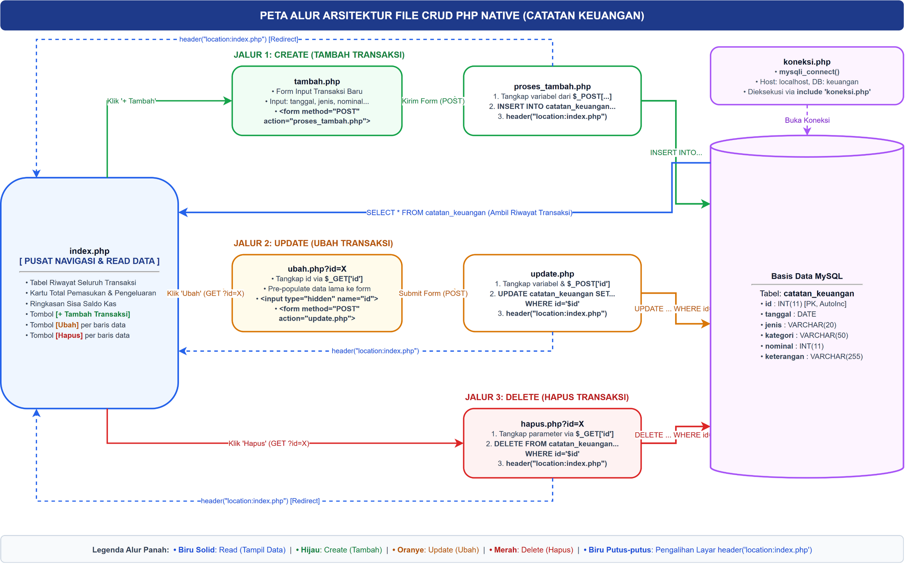
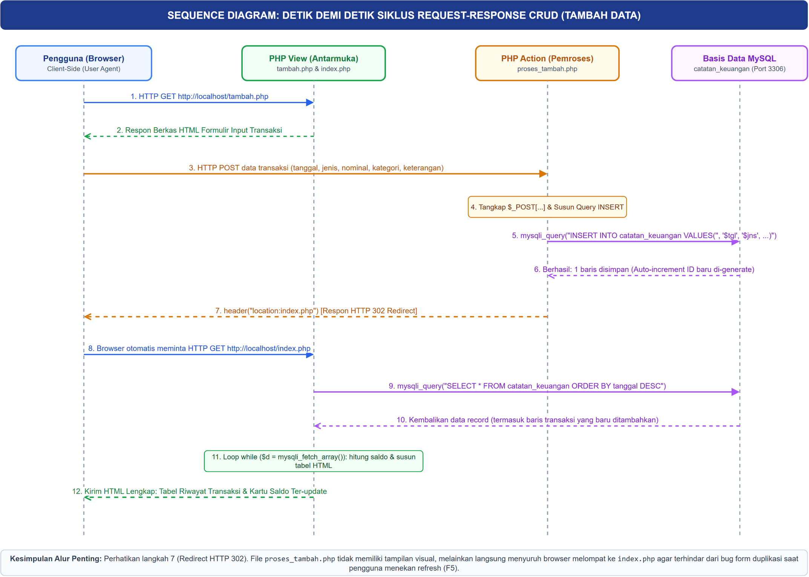

# Modul Panduan Komprehensif: Pemahaman Dari Nol & Bedah Alur Pengerjaan CRUD PHP & MySQLi

> **Untuk Pemula:** Panduan ini ditulis khusus dengan asumsi Anda baru pertama kali mengenal PHP. Setiap konsep, istilah asing, dan baris kode dibedah tuntas dari dasar hingga logika terdalamnya.

---

## DAFTAR ISI
1. [Pondasi Konsep: Bagaimana PHP dan Web Bekerja Sebenarnya](#1-pondasi-konsep-bagaimana-php-dan-web-bekerja-sebenarnya)
2. [Panduan Lengkap Setup PHP di Visual Studio Code (Windows dari Nol)](#2-panduan-lengkap-setup-php-di-visual-studio-code-windows-dari-nol)
3. [Anatomi Sintaks Dasar PHP yang Wajib Dipahami Pemula](#3-anatomi-sintaks-dasar-php-yang-wajib-dipahami-pemula)
4. [Arsitektur Tugas: 3 Entitas Utama (Browser, PHP Server, MySQL)](#4-arsitektur-tugas-3-entitas-utama-browser-php-server-mysql)
5. [Kronologi Detik demi Detik Siklus Request-Response](#5-kronologi-detik-demi-detik-siklus-request-response)
6. [Bedah Baris demi Baris Seluruh File Program](#6-bedah-baris-demi-baris-seluruh-file-program)
   - [6.1 Basis Data: `keuangan.sql`](#61-basis-data-keuangansql)
   - [6.2 Jembatan Koneksi: `koneksi.php`](#62-jembatan-koneksi-koneksiphp)
   - [6.3 Menampilkan Data: `index.php`](#63-menampilkan-data-indexphp)
   - [6.4 Menambah Data: `tambah.php` & `proses_tambah.php`](#64-menambah-data-tambahphp--proses_tambahphp)
   - [6.5 Mengubah Data: `ubah.php` & `update.php`](#65-mengubah-data-ubahphp--updatephp)
   - [6.6 Menghapus Data: `hapus.php`](#66-menghapus-data-hapusphp)
7. [Tanya Jawab Kritis Pemula (FAQ & Pertanyaan 'Mengapa')](#7-tanya-jawab-kritis-pemula-faq--pertanyaan-mengapa)
8. [Kamus Istilah Penting (Glosarium)](#8-kamus-istilah-penting-glosarium)
9. [Uji Mandiri: Uji Pemahaman Logika CRUD Anda](#9-uji-mandiri-uji-pemahaman-logika-crud-anda)

---

## 1. Pondasi Konsep: Bagaimana PHP dan Web Bekerja Sebenarnya

### A. Mengapa File PHP Tidak Bisa Langsung Di-Double Click?
Jika Anda membuat file `halaman.html` di laptop, Anda cukup klik ganda (double-click), dan browser langsung membukanya dengan URL seperti `file:///C:/Users/.../halaman.html`. 

**Namun file `.php` TIDAK BISA diperlakukan seperti itu.** Jika Anda klik ganda file `.php`, yang terbuka adalah Notepad, VS Code, atau browser akan menampilkan teks mentah kodenya tanpa mengeksekusinya.

**Alasannya:**
- Browser (Chrome, Edge, Firefox) **hanya mengerti HTML, CSS, dan JavaScript**. Browser sama sekali tidak tahu apa arti perintah PHP seperti `mysqli_query` atau `$_POST`.
- File PHP membutuhkan **Interpreter (Penerjemah PHP Engine)** dan **Web Server (Apache atau PHP Built-in Server)** untuk membaca kodenya terlebih dahulu.
- URL wajib diawali protokol jaringan lokal: `http://localhost:8000/...` atau `http://localhost/...`.

### B. Analogi Restoran (HTML vs PHP vs Database)
Bayangkan Anda sedang makan di restoran:
1. **Browser (Anda / Pembeli):** Duduk di meja, hanya melihat buku menu dan menerima piring makanan jadi (**HTML & CSS**).
2. **Web Server + PHP (Koki di Dapur):** Menerima pesanan Anda, mengambil bahan-bahan mentah dari kulkas, meracik resep, memasak, dan menaruhnya di piring saji. Kode PHP Anda adalah koki ini!
3. **MySQL (Gudang Bahan Makanan / Kulkas):** Tempat penyimpanan data yang rapi dan terorganisir dalam rak-rak tabel.

```
[Browser Pengguna] ────(1. Minta Halaman)────> [Web Server + PHP]
        ▲                                             │
        │                                    (2. Ambil/Tulis Data)
        │                                             ▼
(4. Terima HTML Jadi) <──(3. Olah Jadi HTML)─── [Database MySQL]
```

---

## 2. Panduan Lengkap Setup PHP di Visual Studio Code (Windows dari Nol)

Banyak pemula mengira cukup memasang VS Code lalu kode PHP bisa langsung dijalankan. Anggapan ini **keliru**. Mari kita pahami konsep dasarnya sebelum memulai instalasi:

> [!IMPORTANT]
> **VS Code bukanlah mesin PHP.** VS Code hanya sebuah *Code Editor* (alat pengetik kode canggih). Agar file `.php` bisa dieksekusi dan dipahami komputer, Anda **wajib menginstal program bahasa PHP (PHP Runtime/Interpreter)** di sistem operasi Windows Anda.

Berikut adalah 6 tahapan praktis untuk menyiapkan lingkungan PHP di VS Code dari nol:

---

### Langkah 1: Memperoleh & Menginstal PHP di Komputer

Ada dua cara untuk mendapatkan program PHP di Windows:

#### Opsi A (Sangat Direkomendasikan untuk Mahasiswa): Gunakan Laragon atau XAMPP
Laragon dan XAMPP adalah paket perangkat lunak "All-in-One". Dengan sekali instalasi, Anda langsung mendapatkan 3 komponen sekaligus:
1. **PHP Interpreter:** Mesin pengeksekusi kode PHP.
2. **MySQL Server:** Server basis data untuk menyimpan tabel.
3. **Apache / Nginx:** Web server pengelola request peramban.

- **Rekomendasi Utama: Laragon** (Unduh di `laragon.org`):
  Setelah diinstal, program PHP Anda otomatis berada di folder:
  `C:\laragon\bin\php\php-8.x.x...`
- **Alternatif Populer: XAMPP** (Unduh di `apachefriends.org`):
  Setelah diinstal, program PHP Anda otomatis berada di folder:
  `C:\xampp\php\`

#### Opsi B: Menginstal Standalone PHP (Hanya PHP Saja)
1. Kunjungi situs resmi: `https://windows.php.net/download/`.
2. Unduh versi **VS16 x64 Thread Safe** dalam format `.zip`.
3. Ekstrak file zip tersebut ke folder lokal baru, misalnya di `C:\php`.

---

### Langkah 2: Memasukkan PHP ke Environment Variables (System PATH) Windows

Agar perintah `php` bisa diketik dan dikenali di terminal mana pun (termasuk terminal VS Code), folder instalasi PHP harus didaftarkan ke *System PATH* Windows.

**Cara Setting di Windows:**
1. Tekan tombol **Windows + S**, ketik `Environment Variables`, lalu pilih **Edit the system environment variables**.
2. Klik tombol **Environment Variables...** di bagian kanan bawah.
3. Pada kotak **System variables** (bagian bawah), cari baris bernama `Path`, lalu klik tombol **Edit...**.
4. Klik tombol **New** di sebelah kanan, lalu masukkan alamat folder tempat file `php.exe` berada:
   - Jika memakai Laragon: `C:\laragon\bin\php\php-8.3.33-Win32-vs16-x64` *(sesuaikan nama foldernya)*
   - Jika memakai XAMPP: `C:\xampp\php`
   - Jika memakai Standalone: `C:\php`
5. Klik **OK** pada seluruh jendela hingga tertutup.

**Uji Hasil Instalasi:**
Buka Command Prompt (CMD) atau Terminal PowerShell baru, lalu ketik:
```bash
php -v
```
Jika muncul keterangan versi seperti `PHP 8.3.x (cli) ...`, artinya **PHP sudah 100% terpasang dan aktif di komputer Anda!**

---

### Langkah 3: Memasang Ekstensi Wajib di Visual Studio Code

Buka VS Code, klik ikon kotak-kotak di bilah menu kiri (**Extensions**) atau tekan pintasan `Ctrl + Shift + X`. Cari dan pasang ekstensi berikut:

1. **PHP Intelephense (oleh Ben Mewburn) — [WAJIB]**
   - Memberikan fitur *IntelliSense* (auto-completion cerdas), penandaan kode warna, saran parameter fungsi, serta pendeteksian otomatis jika ada kode yang salah ketik (*syntax error*).
   - *Tips:* Setelah memasang Intelephense, nonaktifkan saran bawaan VS Code dengan mengetik `@builtin php` di menu ekstensi, lalu klik *Disable* pada "PHP Language Features" agar saran kode tidak muncul ganda.

2. **PHP Server (oleh brapifra) — [SANGAT MEMBANTU]**
   - Memungkinkan Anda menjalankan halaman PHP di browser hanya dengan **1 klik kanan** tanpa perlu mengetik perintah server manual.

---

### Langkah 4: Menghubungkan Path `php.exe` ke VS Code Settings

Agar VS Code dapat memvalidasi kesalahan pengetikan sintaks secara langsung:
1. Di VS Code, buka pengaturan dengan menekan `Ctrl + ,`.
2. Pada kotak pencarian di atas, ketik: `php.validate.executablePath`.
3. Klik tautan **Edit in settings.json**.
4. Tambahkan baris konfigurasi berikut (ingat gunakan garis miring ganda `\\`):
```json
{
  "php.validate.executablePath": "C:\\laragon\\bin\\php\\php-8.3.33-Win32-vs16-x64\\php.exe",
  "php.suggest.basic": false
}
```

---

### Langkah 5: Tiga Cara Menjalankan Program PHP dari VS Code

Setelah instalasi selesai, bagaimana cara membuka aplikasi web Anda di browser? Ada 3 pilihan mudah:

#### Cara 1: Menggunakan PHP Built-in Server dari Terminal VS Code (Paling Fleksibel)
PHP memiliki web server bawaan yang sangat ringan. Anda tidak perlu memindahkan folder ke mana-mana:
1. Buka folder proyek tugas di VS Code (`File > Open Folder...`).
2. Buka terminal terintegrasi di VS Code dengan menekan `Ctrl + ~` (atau menu `Terminal > New Terminal`).
3. Ketik perintah berikut lalu tekan Enter:
   ```bash
   php -S localhost:8000
   ```
4. Buka browser Chrome/Edge, lalu ketik URL: `http://localhost:8000/index.php`.
5. Untuk menghentikan server, klik di terminal lalu tekan `Ctrl + C`.

#### Cara 2: Menggunakan Ekstensi PHP Server (Paling Cepat)
1. Buka berkas `index.php` di editor VS Code.
2. Klik kanan di area kode yang kosong.
3. Pilih opsi **PHP Server: Serve project**.
4. Browser akan terbuka secara otomatis menampilkan proyek Anda.

#### Cara 3: Melalui Laragon / XAMPP Web Root
1. Pindahkan atau buat folder proyek Anda di dalam direktori `www` (Laragon) atau `htdocs` (XAMPP):
   - Laragon: `C:\laragon\www\tugas-php\`
   - XAMPP: `C:\xampp\htdocs\tugas-php\`
2. Buka aplikasi Laragon / XAMPP, lalu klik tombol **Start All**.
3. Buka browser ke alamat: `http://localhost/tugas-php/index.php`.

---

### Langkah 6: Peringatan Krusial Sebelum Menjalankan CRUD Database!

> [!CAUTION]
> **Aplikasi CRUD Catatan Keuangan tidak akan berjalan jika layanan MySQL Server Anda mati.**
> 
> Jika Anda hanya menjalankan PHP tanpa menyalakan MySQL, halaman `index.php` akan melempar pesan kesalahan:
> `Koneksi database gagal : No connection could be made because the target machine actively refused it.`
> 
> **Solusi:**
> Sebelum membuka web di browser, selalu buka aplikasi **Laragon** atau **XAMPP Control Panel**, lalu pastikan tombol **Start** pada bagian **MySQL** sudah diklik dan berjalan di Port **3306**.

---

## 3. Anatomi Sintaks Dasar PHP yang Wajib Dipahami Pemula

Sebelum masuk ke CRUD, perhatikan 5 aturan fundamental bahasa PHP:

### 1. Tag Pembuka dan Penutup
```php
<?php
// Kode PHP ditulis di sini
?>
```
Semua kode PHP **harus** berada di dalam tag `<?php ... ?>`. Teks yang berada di luar tag ini akan dianggap sebagai teks HTML biasa oleh server.

### 2. Variabel Selalu Diawali Tanda Dolar (`$`)
Di PHP, variabel tidak perlu dideklarasikan dengan `var`, `let`, atau tipe data seperti di C/Java. Cukup awali dengan `$`:
```php
$nama = "Adika";     // String (teks)
$nominal = 50000;    // Integer (bilangan bulat)
$status = true;      // Boolean (benar/salah)
```

### 3. Penggabungan Teks (Concatenation) Menggunakan Tanda Titik (`.`)
Banyak pemula salah menggunakan tanda tambah `+` untuk menggabungkan kata. Di PHP:
- Tanda `+` **hanya** untuk matematika: `5 + 10` $\rightarrow$ `15`.
- Tanda titik `.` untuk menyambung teks: `"Halo " . $nama` $\rightarrow$ `"Halo Adika"`.

### 4. Perbedaan Petik Dua (`"..."`) dan Petik Satu (`'...'`)
- **Petik dua (`"..."`)** bersifat pintar (*string interpolation*):
  ```php
  $harga = 5000;
  echo "Harga permen adalah $harga"; // Menghasilkan: Harga permen adalah 5000
  ```
- **Petik satu (`'...'`)** bersifat kaku (literal):
  ```php
  echo 'Harga permen adalah $harga'; // Menghasilkan: Harga permen adalah $harga
  ```

### 5. Array: Lemari Arsip Data
PHP memiliki dua jenis array:
1. **Array Berindeks Angka:**
   ```php
   $kategori = array("Makanan", "Transportasi", "Buku");
   echo $kategori[0]; // Output: Makanan
   ```
2. **Array Asosiatif (Key-Value):** Ini yang **paling sering** digunakan saat mengambil data database:
   ```php
   $transaksi = array(
       "kategori" => "Makanan",
       "nominal"  => 50000
   );
   echo $transaksi['kategori']; // Output: Makanan
   echo $transaksi['nominal'];  // Output: 50000
   ```

---

## 4. Arsitektur Tugas: 3 Entitas Utama (Browser, PHP Server, MySQL)

Tugas ini bertemakan **Aplikasi Catatan Keuangan Pribadi (CRUD 1 Tabel)**. Seluruh sistem tersusun atas 3 pilar:

| Entitas | Peran dalam Tugas | Komponen File |
|:---|:---|:---|
| **1. Basis Data (MySQL)** | Menyimpan seluruh baris transaksi secara permanen di harddisk. | `keuangan.sql` |
| **2. Tampilan Web (Frontend/View)** | Formulir interaksi dan tabel yang dilihat pengguna. | `index.php`, `tambah.php`, `ubah.php` |
| **3. Logika Backend (Controller/Action)** | Menerima data kiriman form, menyusun perintah SQL, dan mengalihkan halaman. | `koneksi.php`, `proses_tambah.php`, `update.php`, `hapus.php` |

### Peta Alur Relasi Berkas (Draw.io):
Berikut adalah diagram rancangan arsitektur hubungan berkas, aliran data formulir, eksekusi query basis data, hingga pengalihan layar (*redirect*):



*Berkas mentah diagram dapat dibuka dan diedit menggunakan Draw.io di: [`diagram/diagram_arsitektur_crud.drawio`](file:///D:/KULIAH-2/ITENAS/WORKTREES/01-SENIN-IFB-211-Pemrograman-Web/01-SENIN/IFB-211-Pemrograman-Web/Tugas/19.10.2026/diagram/diagram_arsitektur_crud.drawio)*

---

## 5. Kronologi Detik demi Detik Siklus Request-Response

Mari kita telusuri alur yang terjadi di komputer saat seorang pengguna menambah transaksi baru melalui diagram sekuens (*Sequence Diagram* Draw.io):



*Berkas mentah diagram dapat dibuka dan diedit menggunakan Draw.io di: [`diagram/diagram_sequence_crud.drawio`](file:///D:/KULIAH-2/ITENAS/WORKTREES/01-SENIN-IFB-211-Pemrograman-Web/01-SENIN/IFB-211-Pemrograman-Web/Tugas/19.10.2026/diagram/diagram_sequence_crud.drawio)*

### Tahapan Urutan Eksekusi:
1. **Langkah 1:** Pengguna mengakses URL `http://localhost/tambah.php` melalui bilah peramban (HTTP GET).
2. **Langkah 2:** Server PHP menyajikan berkas formulir HTML input transaksi kepada pengguna.
3. **Langkah 3:** Pengguna melengkapi formulir dan menekan tombol **SIMPAN TRANSAKSI** (HTTP POST ke `proses_tambah.php`).
4. **Langkah 4:** Skrip `proses_tambah.php` menangkap nilai variabel melalui array superglobal `$_POST[...]` dan menyusun perintah SQL `INSERT`.
5. **Langkah 5:** Server PHP mengirimkan query ke basis data MySQL melalui port 3306 menggunakan `mysqli_query()`.
6. **Langkah 6:** MySQL mengeksekusi penyimpanan baris, meng-generate nilai unik `id` otomatis (*auto-increment*), dan mengirim konfirmasi status berhasil.
7. **Langkah 7:** Skrip PHP mengeksekusi instruksi `header("location:index.php")`, menginstruksikan browser melakukan pengalihan (*HTTP 302 Redirect*).
8. **Langkah 8:** Browser pengguna secara otomatis mengirim permintaan HTTP GET ke `http://localhost/index.php`.
9. **Langkah 9:** Skrip `index.php` mengeksekusi query `SELECT * FROM catatan_keuangan ORDER BY tanggal DESC`.
10. **Langkah 10:** MySQL mengembalikan seluruh record transaksi (termasuk baris baru yang barusan ditambahkan).
11. **Langkah 11:** PHP menjalankan perulangan `while ($d = mysqli_fetch_array(...))` untuk menghitung akumulasi total saldo dan merender baris-baris tabel `<tr><td>...</td></tr>`.
12. **Langkah 12:** Hasil HTML final dikirimkan kembali ke peramban dan ditampilkan lengkap kepada pengguna.

---

## 6. Bedah Baris demi Baris Seluruh File Program

Mari kita bedah setiap berkas yang Anda miliki di direktori tugas.

### 6.1 Basis Data: [`keuangan.sql`](file:///D:/KULIAH-2/ITENAS/WORKTREES/01-SENIN-IFB-211-Pemrograman-Web/01-SENIN/IFB-211-Pemrograman-Web/Tugas/19.10.2026/keuangan.sql)

```sql
CREATE DATABASE IF NOT EXISTS `keuangan`;
USE `keuangan`;

CREATE TABLE IF NOT EXISTS `catatan_keuangan` (
  `id` int(11) NOT NULL AUTO_INCREMENT,
  `tanggal` date NOT NULL,
  `jenis` varchar(20) NOT NULL,
  `kategori` varchar(50) NOT NULL,
  `nominal` int(11) NOT NULL,
  `keterangan` varchar(255) NOT NULL,
  PRIMARY KEY (`id`)
) ENGINE=InnoDB DEFAULT CHARSET=utf8mb4;
```

**Penjelasan Baris demi Baris:**
- `CREATE DATABASE IF NOT EXISTS keuangan;`: Buat basis data bernama `keuangan` bila belum ada.
- `USE keuangan;`: Gunakan database tersebut untuk instruksi di bawahnya.
- `` `id` int(11) NOT NULL AUTO_INCREMENT ``:
  - `int(11)`: Berisi angka bilangan bulat.
  - `NOT NULL`: Tidak boleh kosong.
  - `AUTO_INCREMENT`: **PENTING!** MySQL akan otomatis memberikan nomor urut 1, 2, 3, 4 setiap ada data baru yang masuk. Anda tidak perlu memikirkan nomor ID saat menambah data.
- `` `tanggal` date NOT NULL ``: Menyimpan format tanggal kalender (`YYYY-MM-DD`).
- `` `jenis` varchar(20) NOT NULL ``: Menyimpan teks maksimal 20 huruf (diisi `'Pemasukan'` atau `'Pengeluaran'`).
- `` `kategori` varchar(50) NOT NULL ``: Kategori pengeluaran/pemasukan (misal: "Uang Saku", "Makanan & Minuman").
- `` `nominal` int(11) NOT NULL ``: Menyimpan jumlah rupiah dalam angka tanpa titik (misal `50000`).
- `` `keterangan` varchar(255) NOT NULL ``: Penjelasan detail transaksi.
- `PRIMARY KEY (id)`: Menjadikan kolom `id` sebagai Kunci Utama. Syarat mutlak basis data agar setiap baris data memiliki identitas unik yang tidak mungkin tertukar.

---

### 6.2 Jembatan Koneksi: [`koneksi.php`](file:///D:/KULIAH-2/ITENAS/WORKTREES/01-SENIN-IFB-211-Pemrograman-Web/01-SENIN/IFB-211-Pemrograman-Web/Tugas/19.10.2026/koneksi.php)

```php
<?php
$koneksi = mysqli_connect("localhost", "root", "", "keuangan");

// Cek koneksi database
if (mysqli_connect_errno()){
    echo "Koneksi database gagal : " . mysqli_connect_error();
}
?>
```

**Penjelasan Baris demi Baris:**
- `$koneksi = mysqli_connect(...)`: Membuka sambungan kabel pipa antara PHP dan MySQL.
  - Argumen 1: `"localhost"` $\rightarrow$ Server MySQL berada di komputer lokal yang sama.
  - Argumen 2: `"root"` $\rightarrow$ Username default pengelola basis data MySQL.
  - Argumen 3: `""` $\rightarrow$ Password default (kosong pada instalasi standar Laragon/XAMPP).
  - Argumen 4: `"keuangan"` $\rightarrow$ Nama database yang dituju.
- Objek hasil sambungan ini disimpan di dalam variabel `$koneksi`.
- `if (mysqli_connect_errno())`: Memeriksa apakah terjadi kegagalan (misalnya server MySQL mati atau password salah). Jika gagal, pesan kesalahan dicetak ke layar.

---

### 6.3 Menampilkan Data: [`index.php`](file:///D:/KULIAH-2/ITENAS/WORKTREES/01-SENIN-IFB-211-Pemrograman-Web/01-SENIN/IFB-211-Pemrograman-Web/Tugas/19.10.2026/index.php)

File ini bertugas mengambil data dan menampilkannya dalam tabel. Mari kita bedah potongan-potongan pentingnya:

#### A. Menghitung Total dan Saldo secara Otomatis
```php
include 'koneksi.php';

// Hitung total pemasukan
$q_masuk = mysqli_query($koneksi, "select sum(nominal) as total from catatan_keuangan where jenis='Pemasukan'");
$d_masuk = mysqli_fetch_array($q_masuk);
$total_masuk = $d_masuk['total'] ? $d_masuk['total'] : 0;
```
- `include 'koneksi.php';`: Membawa seluruh isi file `koneksi.php` ke file ini sehingga variabel `$koneksi` bisa langsung dipakai.
- `select sum(nominal) as total ...`: Perintah SQL untuk menjumlahkan semua angka nominal khusus baris yang berjenis `'Pemasukan'`.
- `$d_masuk = mysqli_fetch_array($q_masuk);`: Mengonversi hasil query mentah menjadi array PHP.
- `$total_masuk = ...`: Jika ada data, simpan jumlahnya; jika belum ada catatan pemasukan sama sekali, berikan nilai default `0`.
- Rumus sisa saldo:
  ```php
  $saldo = $total_masuk - $total_keluar;
  ```

#### B. Mengambil Semua Transaksi dan Perulangan Tabel
```php
$data = mysqli_query($koneksi, "select * from catatan_keuangan order by tanggal desc, id desc");
$no = 1;
while($d = mysqli_fetch_array($data)){
?>
    <tr>
        <td class="text-center"><?php echo $no++; ?></td>
        <td><?php echo date('d-m-Y', strtotime($d['tanggal'])); ?></td>
        <td><?php echo $d['kategori']; ?></td>
        <td>Rp <?php echo number_format($d['nominal'], 0, ',', '.'); ?></td>
        <td>
            <a href="ubah.php?id=<?php echo $d['id']; ?>">UBAH</a>
            <a href="hapus.php?id=<?php echo $d['id']; ?>" onclick="return confirm('Apakah Anda yakin...')">HAPUS</a>
        </td>
    </tr>
<?php
}
?>
```
- `select * from catatan_keuangan order by tanggal desc, id desc`: Ambil semua kolom (`*`), urutkan dari tanggal paling baru (`desc` = descending).
- `while($d = mysqli_fetch_array($data))`:
  - **Mengapa pakai `while`?** Karena jumlah baris di tabel tidak bisa ditebak. Perulangan `while` akan terus berputar baris demi baris sampai data habis.
  - Setiap putaran, variabel `$d` berisi satu baris data (misal `$d['kategori']`, `$d['nominal']`).
- `<?php echo $no++; ?>`: Menampilkan nomor urut baris (1, 2, 3...) yang otomatis bertambah setiap putaran.
- `number_format($d['nominal'], 0, ',', '.')`: Fungsi PHP untuk mengubah angka biasa `1200000` menjadi format rupiah yang enak dibaca: `1.200.000`.
- **Tombol Aksi Dinamis:**
  Perhatikan bagian ini:
  ```html
  <a href="ubah.php?id=<?php echo $d['id']; ?>">UBAH</a>
  ```
  Jika baris itu memiliki `id` bernilai 3, maka HTML yang sampai ke browser pengguna adalah:
  ```html
  <a href="ubah.php?id=3">UBAH</a>
  ```
  Ini adalah cara mengirim informasi baris mana yang ingin diedit ke halaman berikutnya lewat URL!

---

### 6.4 Menambah Data: [`tambah.php`](file:///D:/KULIAH-2/ITENAS/WORKTREES/01-SENIN-IFB-211-Pemrograman-Web/01-SENIN/IFB-211-Pemrograman-Web/Tugas/19.10.2026/tambah.php) & [`proses_tambah.php`](file:///D:/KULIAH-2/ITENAS/WORKTREES/01-SENIN-IFB-211-Pemrograman-Web/01-SENIN/IFB-211-Pemrograman-Web/Tugas/19.10.2026/proses_tambah.php)

#### Berkas 1: [`tambah.php`](file:///D:/KULIAH-2/ITENAS/WORKTREES/01-SENIN-IFB-211-Pemrograman-Web/01-SENIN/IFB-211-Pemrograman-Web/Tugas/19.10.2026/tambah.php) (Tampilan Form)
```html
<form method="post" action="proses_tambah.php">
    <input type="date" name="tanggal" required>
    
    <select name="jenis" required>
        <option value="Pengeluaran">Pengeluaran (-)</option>
        <option value="Pemasukan">Pemasukan (+)</option>
    </select>
    
    <input type="text" name="kategori" placeholder="Contoh: Makanan" required>
    
    <input type="number" name="nominal" placeholder="Contoh: 50000" required>
    
    <input type="text" name="keterangan" placeholder="Contoh: Beli makan siang">
    
    <button type="submit">SIMPAN TRANSAKSI</button>
</form>
```
- `action="proses_tambah.php"`: Menentukan file tujuan pengiriman data saat tombol submit ditekan.
- `method="post"`: Mengirim data di balik layar (*HTTP Body*).
- Setiap input diberi atribut `name="..."`. Nama inilah yang akan menjadi kata kunci di file pemroses.

#### Berkas 2: [`proses_tambah.php`](file:///D:/KULIAH-2/ITENAS/WORKTREES/01-SENIN-IFB-211-Pemrograman-Web/01-SENIN/IFB-211-Pemrograman-Web/Tugas/19.10.2026/proses_tambah.php) (Pemroses Logika)
```php
<?php 
// 1. Hubungkan ke basis data
include 'koneksi.php';

// 2. Tangkap data yang dikirim dari form tambah.php
$tanggal    = $_POST['tanggal'];
$jenis      = $_POST['jenis'];
$kategori   = $_POST['kategori'];
$nominal    = $_POST['nominal'];
$keterangan = $_POST['keterangan'];

// 3. Masukkan data ke tabel catatan_keuangan
mysqli_query($koneksi, "insert into catatan_keuangan values('', '$tanggal', '$jenis', '$kategori', '$nominal', '$keterangan')");

// 4. Alihkan kembali halaman ke index.php
header("location:index.php");
?>
```
- `$_POST['tanggal']`: Mengambil isi ketikan user dari input yang memiliki atribut `name="tanggal"`.
- `insert into catatan_keuangan values('', '$tanggal', ...)`:
  - Mengapa nilai pertama petik kosong `''`? Karena kolom pertama adalah `id` yang sifatnya `AUTO_INCREMENT`. Kita cukup kirim string kosong `''`, dan MySQL yang akan otomatis memberi nomor urut berikutnya!
- `header("location:index.php")`:
  - **Fungsi ajaib pemindah layar.** File pemroses ini tidak memiliki tampilan HTML sama sekali. Begitu query selesai dieksekusi dalam hitungan milidetik, fungsi ini menyuruh browser langsung melompat kembali ke halaman `index.php` sehingga pengguna melihat datanya sudah bertambah.

---

### 6.5 Mengubah Data: [`ubah.php`](file:///D:/KULIAH-2/ITENAS/WORKTREES/01-SENIN-IFB-211-Pemrograman-Web/01-SENIN/IFB-211-Pemrograman-Web/Tugas/19.10.2026/ubah.php) & [`update.php`](file:///D:/KULIAH-2/ITENAS/WORKTREES/01-SENIN-IFB-211-Pemrograman-Web/01-SENIN/IFB-211-Pemrograman-Web/Tugas/19.10.2026/update.php)

Ini adalah bagian yang paling sering membuat pemula bingung. Mari kita perhatikan baik-baik.

#### Mengapa Proses Edit Butuh 2 Langkah?
Jika Anda ingin mengedit transaksi nomor 4, formulir edit **tidak boleh kosong**. Formulir tersebut harus sudah terisi data lama dari transaksi nomor 4 (misal tanggalnya, nominalnya yang lama), baru kemudian Anda ubah bagian yang salah dan tekan tombol simpan.

#### Berkas 1: [`ubah.php`](file:///D:/KULIAH-2/ITENAS/WORKTREES/01-SENIN-IFB-211-Pemrograman-Web/01-SENIN/IFB-211-Pemrograman-Web/Tugas/19.10.2026/ubah.php)
```php
<?php
include 'koneksi.php';

// 1. Ambil ID dari URL (contoh: ubah.php?id=4)
$id = $_GET['id'];

// 2. Ambil data transaksi yang HANYA memiliki ID tersebut
$data = mysqli_query($koneksi, "select * from catatan_keuangan where id='$id'");
while($d = mysqli_fetch_array($data)){
?>
<form method="post" action="update.php">
    <!-- PENTING: Input tersembunyi untuk menyimpan ID -->
    <input type="hidden" name="id" value="<?php echo $d['id']; ?>">

    <label>Tanggal Transaksi</label>
    <input type="date" name="tanggal" value="<?php echo $d['tanggal']; ?>" required>

    <label>Jenis Transaksi</label>
    <select name="jenis" required>
        <option value="Pemasukan" <?php if($d['jenis'] == 'Pemasukan') echo 'selected'; ?>>Pemasukan (+)</option>
        <option value="Pengeluaran" <?php if($d['jenis'] == 'Pengeluaran') echo 'selected'; ?>>Pengeluaran (-)</option>
    </select>

    <label>Kategori</label>
    <input type="text" name="kategori" value="<?php echo $d['kategori']; ?>" required>

    <label>Nominal (Rp)</label>
    <input type="number" name="nominal" value="<?php echo $d['nominal']; ?>" required>

    <label>Keterangan / Catatan</label>
    <input type="text" name="keterangan" value="<?php echo $d['keterangan']; ?>">

    <button type="submit">UPDATE DATA</button>
</form>
<?php 
}
?>
```

**Konsep Kunci di Sini:**
1. `$id = $_GET['id'];`: Menangkap angka `4` dari tautan `ubah.php?id=4`.
2. `where id='$id'`: Memastikan MySQL hanya mengambil baris milik transaksi nomor 4, bukan yang lain.
3. `value="<?php echo $d['tanggal']; ?>"`: Ini cara memasukkan data lama ke dalam kotak input HTML. Kotak input langsung terisi tulisan lama.
4. `<?php if($d['jenis'] == 'Pemasukan') echo 'selected'; ?>`: Logika percabangan untuk memilih opsi dropdown mana yang sedang aktif saat ini.
5. `<input type="hidden" name="id" value="<?php echo $d['id']; ?>">`:
   - **MENGAPA HARUS ADA INPUT HIDDEN?**
   - Kotak input ini tidak terlihat oleh mata pengguna di layar. Tapi saat form di-submit ke `update.php`, data `id` ini ikut terkirim. Tanpa data `id` ini, file `update.php` tidak akan pernah tahu transaksi baris ke berapa yang ingin diubah!

#### Berkas 2: [`update.php`](file:///D:/KULIAH-2/ITENAS/WORKTREES/01-SENIN-IFB-211-Pemrograman-Web/01-SENIN/IFB-211-Pemrograman-Web/Tugas/19.10.2026/update.php)
```php
<?php 
include 'koneksi.php';

// 1. Tangkap seluruh data, termasuk ID baris
$id         = $_POST['id'];
$tanggal    = $_POST['tanggal'];
$jenis      = $_POST['jenis'];
$kategori   = $_POST['kategori'];
$nominal    = $_POST['nominal'];
$keterangan = $_POST['keterangan'];

// 2. Eksekusi query UPDATE
mysqli_query($koneksi, "update catatan_keuangan set tanggal='$tanggal', jenis='$jenis', kategori='$kategori', nominal='$nominal', keterangan='$keterangan' where id='$id'");

// 3. Kembali ke index.php
header("location:index.php");
?>
```

> [!WARNING]
> Perhatikan klausa `where id='$id'` di ujung perintah `UPDATE`.
> Jika Anda lupa mengetikkan `where id='$id'`, perintah SQL akan berbunyi: "Ubah semua data transaksi di tabel menjadi data ini". Akibatnya, seluruh riwayat transaksi Anda akan tertimpa dan menjadi seragam!

---

### 6.6 Menghapus Data: [`hapus.php`](file:///D:/KULIAH-2/ITENAS/WORKTREES/01-SENIN-IFB-211-Pemrograman-Web/01-SENIN/IFB-211-Pemrograman-Web/Tugas/19.10.2026/hapus.php)

File ini adalah file pemroses paling ringkas:

```php
<?php 
include 'koneksi.php';

// 1. Menangkap ID yang dikirim dari URL
$id = $_GET['id'];

// 2. Menghapus data dari database
mysqli_query($koneksi, "delete from catatan_keuangan where id='$id'");

// 3. Mengalihkan halaman kembali ke index.php
header("location:index.php");
?>
```

**Alur Kejadian:**
1. Di `index.php`, pengguna mengklik tombol: `<a href="hapus.php?id=5">HAPUS</a>`.
2. Browser mengirim permintaan HTTP GET ke `hapus.php?id=5`.
3. Skrip `hapus.php` mengambil angka `5` via `$_GET['id']`.
4. Perintah `delete from catatan_keuangan where id='5'` dijalankan. Baris ke-5 terhapus permanen dari MySQL.
5. `header("location:index.php")` me-refresh layar kembali ke daftar transaksi. Baris ke-5 sudah tidak ada lagi.

---

## 7. Tanya Jawab Kritis Pemula (FAQ & Pertanyaan 'Mengapa')

### Q1: Kapan saya harus pakai `$_GET` dan kapan harus pakai `$_POST`?
- Gunakan `$_GET`:
  - Ketika data tidak bersifat rahasia dan dikirim melalui link / URL.
  - Contoh: Tombol hapus (`hapus.php?id=5`) dan tombol edit (`ubah.php?id=5`), atau pencarian kata kunci (`cari.php?keyword=buku`).
- Gunakan `$_POST`:
  - Ketika mengirim formulir input pengguna (`<form method="POST">`).
  - Data yang dikirim berukuran besar, banyak kolom, atau memuat informasi sensitif (misal password, uang). Data ini tidak terlihat di bilah URL browser.

### Q2: Mengapa file `tambah.php` dan `proses_tambah.php` dipisah menjadi dua file berbeda?
Secara teknis, kita bisa menggabungkannya dalam satu file. Namun, dalam standar pemrograman yang baik:
1. **Pemisahan Tanggung Jawab (Separation of Concerns):** `tambah.php` fokus mengatur desain tampilan HTML/CSS, sedangkan `proses_tambah.php` fokus memproses data ke database.
2. **Mencegah Masalah Form Resubmission (F5 / Refresh Bug):** Jika proses simpan ditaruh di halaman yang sama dengan form, saat pengguna me-refresh browser, form akan terkirim dua kali dan data akan menjadi duplikat (ganda). Dengan pola `Form` $\rightarrow$ `Proses` $\rightarrow$ `Redirect ke Index`, masalah ini 100% terhindar.

### Q3: Mengapa tag PHP `<?php ... ?>` dibuka dan ditutup berulang-ulang di file `index.php`?
Perhatikan contoh ini:
```php
<?php while($d = mysqli_fetch_array($data)) { ?>
    <tr>
        <td><?php echo $d['kategori']; ?></td>
    </tr>
<?php } ?>
```
Ini adalah keunggulan terbesar PHP: **PHP dirancang untuk bisa disisipkan (embedded) di dalam HTML**.
Daripada mengetik kode HTML yang panjang di dalam perintah `echo "<tr><td>..."`, para programmer PHP lebih suka menutup tag `?>`, mengetik kode HTML murni dengan rapi, lalu membuka kembali `<?php` untuk menutup kurung kurawal `}`.

---

## 8. Kamus Istilah Penting (Glosarium)

- **Client-Side:** Segala hal yang berjalan dan diproses di perangkat komputer pengguna (contoh: browser Chrome merender HTML, CSS, dan animasi JavaScript).
- **Server-Side:** Segala hal yang diproses di komputer server sebelum hasilnya dikirim ke browser (contoh: PHP membaca basis data, mengecek login).
- **CRUD:** Singkatan dari *Create* (Buat), *Read* (Baca/Tampil), *Update* (Ubah/Perbarui), *Delete* (Hapus). Empat pilar utama seluruh aplikasi berbasis database di dunia.
- **MySQLi:** *MySQL Improved*, pustaka ekstensi resmi di PHP untuk berkomunikasi dengan basis data MySQL. Huruf `i` di belakangnya berarti *Improved* (penyempurnaan dari fungsi `mysql_` versi lawas).
- **Superglobal:** Variabel bawaan PHP yang otomatis tersedia di seluruh bagian program tanpa perlu dibuat manual, diawali garis bawah kapital (misal `$_GET`, `$_POST`, `$_SESSION`).
- **Primary Key:** Kunci pengenal unik pada tabel basis data yang nilainya tidak boleh sama antara satu baris dengan baris lainnya (dalam tugas kita adalah kolom `id`).
- **Auto Increment:** Fitur MySQL yang otomatis menaikkan angka ID (1, 2, 3, 4...) setiap kali baris baru ditambahkan.
- **Redirect:** Tindakan server menginstruksikan browser agar secara otomatis berpindah ke alamat URL lain (di PHP menggunakan fungsi `header("location:...")`).

---

## 9. Uji Mandiri: Uji Pemahaman Logika CRUD Anda

Untuk memastikan Anda benar-benar memahami materi ini dan siap saat ditanya dosen atau kuis, coba jawab 3 pertanyaan skenario ini:

1. **Skenario 1:**
   > *Jika di masa depan Anda diminta menambahkan 1 kolom baru bernama `metode_pembayaran` (misal: "Tunai", "Transfer Bank", "QRIS"), berkas mana saja yang harus Anda ubah?*
   >
   > **Jawaban yang benar:**
   > 1. `keuangan.sql`: Tambahkan kolom baru di tabel basis data.
   > 2. `tambah.php`: Tambahkan elemen `<select name="metode_pembayaran">` di formulir.
   > 3. `proses_tambah.php`: Tangkap `$_POST['metode_pembayaran']` dan masukkan ke query `INSERT`.
   > 4. `index.php`: Tambahkan header kolom `<th>` dan cetak isi `<td><?php echo $d['metode_pembayaran']; ?></td>`.
   > 5. `ubah.php`: Tambahkan field input tersebut beserta nilai lamanya.
   > 6. `update.php`: Tambahkan variabel tersebut ke dalam query `UPDATE ... SET`.

2. **Skenario 2:**
   > *Apa yang terjadi jika atribut `name="nominal"` di file `tambah.php` tidak sengaja terhapus?*
   >
   > **Jawaban yang benar:**
   > Di file `proses_tambah.php`, pemanggilan `$_POST['nominal']` akan menghasilkan pesan kesalahan *Warning: Undefined array key "nominal"*, dan nilai yang masuk ke database akan bernilai 0 atau kosong karena PHP tidak menerima kiriman data tersebut dari browser.

3. **Skenario 3:**
   > *Mengapa tombol Hapus tidak membutuhkan berkas formulir seperti Tambah dan Edit?*
   >
   > **Jawaban yang benar:**
   > Karena menghapus data tidak memerlukan input ketikan baru dari pengguna. Sistem hanya membutuhkan satu informasi: **"ID baris mana yang ingin dihapus?"**. Informasi ID tersebut cukup dikirimkan melalui URL (`hapus.php?id=...`) dan langsung dieksekusi oleh query `DELETE`.
